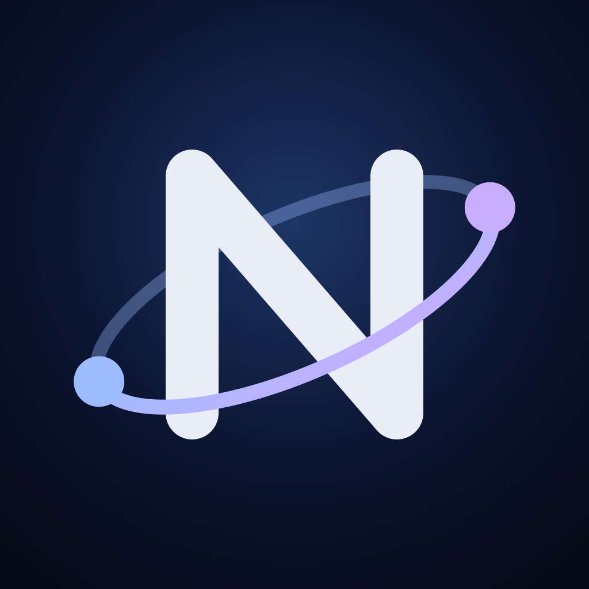

<div align="center">



# NexusAI

**Local language models on a PS5, with an authenticated model-control API.**<br>
NexusAI is the inference backend of the [Nexus](https://github.com/ljcatherine/Nexus) ecosystem: a native PS5 app with a dashboard, an OpenAI-compatible API and an opt-in control API for switching models remotely.

[](CHANGELOG.md)
[](LICENSE)
[](#control-api)
[](https://github.com/ljcatherine/Nexus)

[Build](#build) ·
[Control API](#control-api) ·
[Security](#security) ·
[Testing](docs/TESTING.md) ·
[Setup guide](https://nexus.liamjc.dev/docs/backend/nexusai/) ·
[Credits](#credits-and-licence)

</div>

---

## What it is

| Port | Service | Who uses it |
|---|---|---|
| **:8081** | OpenAI-compatible inference (`/v1/models`, `/v1/chat/completions`) | Every Nexus client, through the gateway |
| **:8082** | NexusAI control API: status, installed models, load and unload | The Nexus gateway on Debian, with a bearer token |
| Console | NexusAI dashboard: generation speed, memory, context, thermals, current model | You, on the TV |

Inference on :8081 is unchanged from the upstream app and keeps its GPU path. The control API on :8082 is
new, off by default, and only starts once you provision a token hash.

NexusAI is built reproducibly: [`prepare-build.sh`](prepare-build.sh) downloads a pinned upstream
revision, applies the patches in [`patches/`](patches) and copies in the NexusAI sources from
[`native/`](native). Nothing is vendored.

## Build

> [!NOTE]
> Needs Git and Bash. Building the PS5 title also needs the upstream PS5 toolchain (PS5_Vulkan and the PS5 homebrew SDK).
> NexusAI does not supply console exploits, signing keys or homebrew prerequisites.

```bash
./prepare-build.sh            # clone the pinned upstream revision into build/nexusai and apply the patches
./test-control.sh             # host-side C++ tests for the control API
```

Then, inside `build/nexusai`, follow the upstream `docs/CONSOLE.md`: initialise the pinned submodules,
install the PS5 toolchain and run `scripts/build-app.sh`.

A passing host-side test does **not** prove a working PS5 binary or firmware compatibility. Test in a
non-production homebrew setup first, keep a copy of the original title, and follow
[docs/TESTING.md](docs/TESTING.md) for a safe first install under a separate test title ID.

## Control API

| Request | Result |
|---|---|
| `GET /v1/nexus/status` | State, active model, context used and capacity, prompt and generation speed, memory pool, free, model and KV cache, load progress |
| `GET /v1/nexus/models` | Installed models: stable ID, label, drive, `fits` and `current` flags, plus `file_size_bytes`, `architecture` and `quantization_type` where known |
| `POST /v1/nexus/models/{16-hex-id}/load` | `202`. Queues a GPU-safe restart into that model |
| `POST /v1/nexus/models/unload` | `202`. Queues a restart with no model |
| `GET /v1/nexus/logs/app`, `GET /v1/nexus/logs/llama` | The newest lines of the app or llama.cpp log (up to 64 KiB) as `{"source","next","lines"}` |
| `GET /v1/nexus/logs/{app\|llama}?after=<next>` | Only the lines written since that cursor. Poll it to follow a log |

Every request needs `Authorization: Bearer <token>`. Model IDs resolve only to models the app has
already found and approved; unknown IDs, incompatible models, concurrent switches and other methods are
refused. There is no API for arbitrary paths, writing files, running commands, downloads or model server
arguments.

Switching models **restarts the app** to free Vulkan memory, so inference and streaming pause. Poll
`/v1/nexus/status` until the new model reports ready.

Logs are followed by polling, not a held-open stream: pass each reply's `next` back as `after`. Both
logs start again when the app restarts, so after a model switch ask without `after` once. Logs name
model files and LAN addresses; they are served only to the bearer token, like everything else here.

<details>
<summary><b>Model metadata details</b></summary>

- `file_size_bytes`: exact file size from the planner scan, or `null`.
- `architecture`: the GGUF `general.architecture`, or `null`.
- `quantization_type`: the GGUF `general.file_type` code, or `null`. It's never guessed from the file
  name, and unknown future codes are passed through as unknown. It describes the file's main
  quantization, not every tensor.

Older responses without these fields are still accepted by Nexus clients.

</details>

## Security

The control API starts only when you provision it. The app's state folder is `/data/PS5LM`
(or `/download0/PS5LM` when sandboxed), and two files there control it:

| File | Purpose |
|---|---|
| `nexus-control.token` | One line, `sha256:<64 lowercase hex>`, mode `0600` or stricter. It holds only the SHA-256 of a 32–128 character random token. Keep the token itself in the gateway's private config and the Nexus Keychain. Without a valid file, the controller doesn't start. |
| `nexus-control.lan` | Optional empty marker. Binds `0.0.0.0:8082` instead of `127.0.0.1:8082`, so a gateway on another machine can reach it. |

> [!IMPORTANT]
> :8081 and :8082 speak plain HTTP. Never expose them to the internet or port-forward them. Firewall
> :8082 so only your gateway can reach it, and route remote access through an authenticated HTTPS gateway
> such as Nexus with Cloudflare Access, or a private overlay network.

Storing only a hash limits what leaks if the console's files are read, but it does not protect a token
sent over an untrusted network. See [SECURITY.md](SECURITY.md) to report a vulnerability.

## Tests and limits

| Test | What it covers |
|---|---|
| [`native/nexus_control_test.cpp`](native/nexus_control_test.cpp) | Fail-closed token setup, private-file permissions, hash validation, authentication, JSON escaping, inventory, status, invalid selection, exclusive switching, log paging |
| [`tests/`](tests) | The PS5 JSON numeric-locale fix and control-file owner repair |
| [`scripts/`](scripts) | Benchmark, security preflight and service provenance checks, each with tests |
| [`test_verify_title.py`](test_verify_title.py) | Offline title integrity check before a first PS5 test |

The host tests compile with a standard C++20 compiler, without the PS5 SDK. A full PS5 title
cross-compiles and passes offline package checks. Live PS5 runtime, real model loads, long-run stability
and end-to-end authenticated use are not yet verified. The JSON numeric fix is described in
[docs/JSON-NUMERIC-CRASH.md](docs/JSON-NUMERIC-CRASH.md).

## Layout

| Path | What it holds |
|---|---|
| [`prepare-build.sh`](prepare-build.sh) | Clones the pinned upstream revision and applies everything |
| [`test-control.sh`](test-control.sh) | Builds and runs the host-side control API tests |
| [`native/`](native) | NexusAI control API and console helpers (C++ and C) |
| [`patches/`](patches) | Changes applied to the upstream app: control API, locale fix, branding, model metadata, executable modes, provisioning |
| [`tests/`](tests), [`benchmarks/`](benchmarks), [`scripts/`](scripts) | Tests, benchmark and operational checks |
| [`prepare-test-identity.py`](prepare-test-identity.py), [`verify-test-title.py`](verify-test-title.py) | Safe test-title tooling |
| [`docs/`](docs) | Testing guide and technical notes |

## Credits and licence

NexusAI is a modified version of **[PS5LM Plus](https://github.com/abhi245y/PS5LM-Plus)** by abhi245y,
which grew out of **[PS5LM](https://github.com/cobanov/PS5LM)** by Mert Cobanov: the llama.cpp port to
the PS5, its payload and the native GPU app all come from that work. NexusAI adds the control API, the
dashboard branding, model metadata and the provisioning and test tooling.

Built against upstream revision `6729b4acbaf65e23b2e8bc8708b2acba524a7aa8`. Like the projects it builds
on, NexusAI is free software under the **GNU General Public License v3.0 or later**. See [LICENSE](LICENSE).

<div align="center">
<sub>Part of <a href="https://github.com/ljcatherine/Nexus">Nexus</a> · <a href="https://nexus.liamjc.dev">nexus.liamjc.dev</a></sub>
</div>
