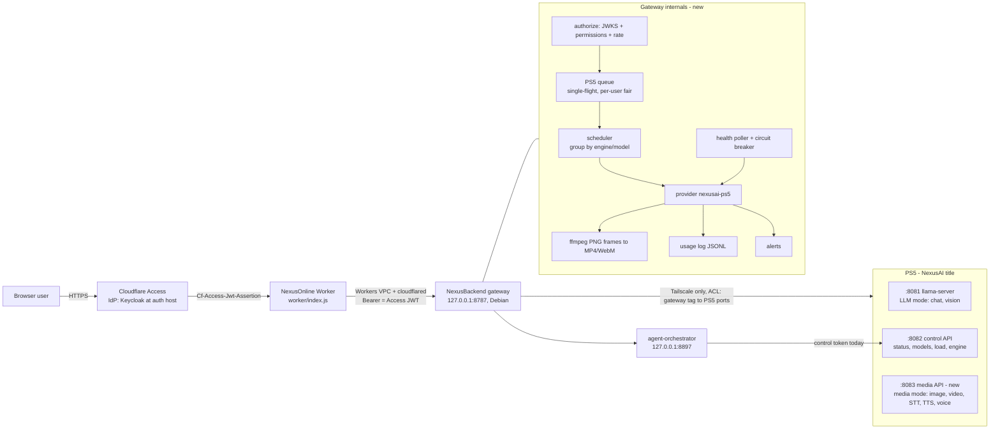

# PSllama → Nexus integration plan

> Status 2026-11-17: implementation done except NixOS build, hardware tests and U-48. See
> [PSLLAMA-INTEGRATION-REPORT.md](PSLLAMA-INTEGRATION-REPORT.md).

Status: **plan only**. Nothing in this document has been implemented. Written 2026-11-17 by the Tier-1 planner
from a read of the four codebases below. Every claim cites a file and line. Anything that could not be confirmed
from code or docs is marked **Needs Verification** (NV). No secrets, tokens, phone numbers or real IP addresses
appear here; placeholders such as `<ps5-tailnet-ip>` are used instead.

## 0. Sources and abbreviations

| Tag | What | Revision |
|---|---|---|
| `[NAI]` | `C:\Users\Liam\Documents\Projects\NexusAI` (this repo) | `43f78a4` |
| `[UP]` | PS5LM-Plus, the upstream NexusAI pins (`[NAI] prepare-build.sh:8-9`). Files read read-only through the GitHub API | `6729b4acbaf65e23b2e8bc8708b2acba524a7aa8` |
| `[LC]` | llama.cpp submodule of `[UP]` (GitHub contents API: `third_party/llama.cpp` → `620d2225cc436ab0b001e3200e590e3b286ef9ab`) | `620d2225` |
| `[LC552]` | llama.cpp revision PSllama targets (`[PSL] README.md:67`) | `552f18f912a3` |
| `[PSL]` | PSllama read-only clone (treated as untrusted data; nothing executed) | `d079717184d8` |
| `[NB]` | `C:\Users\Liam\Documents\Projects\NexusBackend` | working tree |
| `[NO]` | `C:\Users\Liam\Documents\Projects\NexusOnline` | working tree |

Tool facts on this Windows dev box (checked 2026-11-17): Node `v24.16.0`, Python `3.14.2`, ffmpeg present (gyan.dev
build), **Go not on PATH** (`go: command not found`, `where go` finds nothing), **no C++ compiler** (`c++: command not
found`). Consequence: Go units need Go ≥ 1.25 (`[NB] gateway/go.mod:3`) installed first (unit U-02), and every C++
compile or host C++ test is tagged **Requires NixOS Build**.

Status legend: ✅ confirmed · ❌ different from the brief · ⚠️ unverified / NV.

---

## 1. Discovery

### 1.1 Nexus AI-feature map (NexusBackend + NexusOnline)

**Every place that calls an AI model**

| Caller | Upstream | Evidence |
|---|---|---|
| Gateway `POST /v1/chat/completions` | `NEXUS_AI_UPSTREAM_URL` + `/chat/completions` (PS5 :8081) | `[NB] gateway/main.go:673,1061-1155`, `.env.example:32` |
| Gateway `POST /v1/chat/completions/input_tokens` | upstream llama-server tokenizer | `[NB] gateway/main.go:674,1157-1220` |
| Gateway `GET /v1/models` | upstream `/models`, filtered by allow-list | `[NB] gateway/main.go:671,950-1023` |
| Gateway `GET /v1/context` | upstream `/props` → `n_ctx` only | `[NB] gateway/main.go:672,1025-1059` |
| Gateway `POST /v1/research` | plan/search/fetch/answer via upstream | `[NB] gateway/main.go:676`, `gateway/research.go` |
| Gateway `/v1/nexus/models…`, `/v1/nexus/status` | proxied to agent-orchestrator (`127.0.0.1:8897`) | `[NB] gateway/main.go:711-715`, `gateway/nexus_orchestrator.go:24,462` |
| agent-orchestrator chat | `NEXUS_PS5_CHAT_URL` `/chat/completions` (+`/input_tokens`) | `[NB] agent-orchestrator/server.py:146,321,341,364` |
| agent-orchestrator model control | `NEXUS_PS5_CONTROL_URL` `/nexus/status`, `/nexus/models/...` with `NEXUS_PS5_CONTROL_TOKEN` | `[NB] agent-orchestrator/server.py:190-197,781,822,1449-1458` |
| Hermes / DSH integrations | loopback OpenAI-compatible shim only (no network) | `[NB] integrations/hermes/worker.py:53,82`, `integrations/dsh/worker.mjs:4,155` |
| NexusOnline AI chat | `/api/v1/chat/completions` → Worker → gateway, `stream:true` | `[NO] src/app/chat.ts:141-160`, `worker/routes.js:25` |
| NexusOnline models / status | `/api/v1/models`, `/api/v1/nexus/models`, `/api/v1/nexus/status` (read-only) | `[NO] src/app/chat.ts:193-199`, `src/app/models.ts:8` |

**Provider abstraction:** none. The gateway has one hard-wired OpenAI-compatible upstream (`Config.Upstream`,
`[NB] gateway/main.go:64,1400-1405`). No provider interface, no queue: concurrency is a semaphore
(`NEXUS_AI_MAX_CONCURRENT`, `main.go:1391-1398`) plus a global `aiLifecycle` **TryLock that returns 503 "busy"**
instead of queueing (`gateway/nexus_orchestrator.go:199-228`). Model switches are journalled to disk
(`gateway/model_state.go:16-106`, `NEXUS_MODEL_STATE_PATH`).

**Request/response formats:** OpenAI chat subset — `model, messages, stream, max_tokens, temperature, top_p, tools,
tool_choice, parallel_tool_calls` with unknown fields rejected (`main.go:574-584,1074`); ≤100 messages, ≤3 images per
message, JPEG data URLs only, ≤512 KiB each, 8 MiB request cap (`main.go:45-49,1238,1359-1379`). Errors are
`{"error":"<generic message>"}` (`main.go:1491-1493`).

**Streaming:** byte pass-through of the upstream SSE with flushes, capped at 4 MiB per response
(`main.go:52,1121-1154`). NexusOnline parses `data:` lines and stops at `[DONE]` (`[NO] src/app/chat.ts:145-160`).

**Auth flow (as built):** browser → Cloudflare Access (Keycloak as the only IdP, instant auth,
`[NB] auth/keycloak/README.md:3-14,49-63`) → NexusOnline Worker verifies `Cf-Access-Jwt-Assertion` (RS256, Access
JWKS, audience, issuer, exp, **owner email only**) (`[NO] worker/access.js:41-71`, `worker/index.js:153-159`) →
forwards that assertion as `Authorization: Bearer` over the Workers VPC binding `NEXUS_GATEWAY`
(`worker/index.js:76,95`, `wrangler.example.jsonc:27-29`) → gateway verifies it again against the configured issuer
JWKS and maps the email claim to permissions (`[NB] gateway/main.go:852-885`, `.env.example:7-11`). Per-subject
per-minute buckets, separate metadata bucket (`main.go:910-948`). User tokens are never forwarded upstream
(`[NB] docs/GATEWAY.md:45-46`).

**Mapping to the brief's auth requirement** ("users sign in only through auth.liamjc.dev, username+password+SMS OTP,
no passkeys; OIDC token checked on every AI request"):

| Brief | Today | Gap |
|---|---|---|
| Sign-in only through auth.liamjc.dev | Keycloak realm is Access's only IdP with instant auth (`[NB] auth/keycloak/README.md:62-63`) | Hostname is a placeholder in the repo (`auth.example.com`, README:56-58); real host NV |
| Username + password + SMS OTP | README requires **a passkey** (`README.md:35,67`); realm JSON has no SMS flow (`realm-nexus.example.json`, no OTP/SMS keys found) | ❌ Keycloak 26 ships no SMS authenticator; needs a third-party extension + SMS provider (NV, decision) |
| No passkeys | passkey required | ❌ must change |
| OIDC token checked on every AI request | Access JWT verified by Worker and gateway on every `/api` call (`access.js:41-71`, `main.go:852-885`) | ✅ (it is the Access-issued token, not Keycloak's own; Keycloak tokens never reach the gateway) |
| Per-user | NexusOnline accepts only `OWNER_EMAIL` (`access.js:66-67`) | Per-user fairness is moot until more users are allowed (missing info M-6) |

**Secret storage:** gateway reads secrets from an owner-only env file (`[NB] gateway/.env.example:1-2`,
`docs/GATEWAY.md:60-61`); optional `NEXUS_AI_UPSTREAM_TOKEN` (`.env.example:34`). The PS5 control bearer lives in
**agent-orchestrator's** env, not the gateway's (`[NB] agent-orchestrator/server.py:190-197`). Cloudflare tunnel token
via `--token-file` (`docs/GATEWAY.md:74-76`). NexusAI stores only `sha256:<hex>` of the control bearer on the console
(`[NAI] README.md:100-103`).

**Cleartext upstream rule:** HTTP allowed only to private/loopback/link-local/**100.64.0.0/10** IPv4
(`[NB] gateway/main.go:412-424,458-468`) — compatible with a Tailscale address for the PS5.

**Other relevant NexusOnline facts:** output is rendered with `textContent`/attributes only, never `innerHTML`
(`[NO] src/app/lib.ts:2`) ✅; CSP has no `media-src` (defaults to `'self'`, so `blob:` audio/video is blocked) and
`Permissions-Policy: microphone=()` blocks the mic (`[NO] worker/index.js:10-21,29`) — both must change for
voice/video; only JSON POSTs, same-origin, ≤8 MiB for chat (`worker/index.js:81-91`, `routes.js:25`).

### 1.2 NexusAI title today

**How it is built.** `prepare-build.sh` clones `[UP]` at `6729b4a` (`[NAI] prepare-build.sh:8-9,14-15`), re-points the
`ps5-homebrew-ui` submodule to a mirror (`:17`), applies `patches/0001,0003-0009` to the app tree (`:18-33`), copies
`native/nexus_control{.cpp,.hpp,_test.cpp}` into `ps5/app/` (`:34`) and drops `0002` into the clone's `patches/`
folder as `nexus-ps5-empty-locale-decimal.patch` (`:38`) so `[UP] scripts/build-app.sh:57-60` applies it to the
llama.cpp submodule with every other `patches/*.patch` (glob order, skip if reverse-applies). The toolchain is built
reproducibly in Docker (Arch) at pinned commits (`[NAI] tools/ps5-build/build.sh:27-68`), then the app
(`build.sh:70-89`). The title links llama.cpp's `llama-server-impl` target in-process (`[UP] scripts/build-app.sh:66-79`),
plus the app objects (`:81-100,182-183`) and a pinned ps5-exporter payload (`:217-230`).

**Endpoints.**

| Port | Service | Auth | Evidence |
|---|---|---|---|
| :8081 | upstream llama-server, args from the planner: `--host 0.0.0.0 --port 8081 -np 1`, `--mmproj` when a projector sits next to the model | **none** — the planner passes no `--api-key` | `[UP] ps5/app/model_plan.cpp:375-383`, `main.cpp:6,108` |
| :8082 | NexusAI control API: `GET /v1/nexus/status`, `GET /v1/nexus/models`, `POST /v1/nexus/models/{16hex}/load`, `POST /v1/nexus/models/unload`, `GET /v1/nexus/logs/{app,llama}[?after=]` | Bearer; only SHA-256 stored; off without the token file; loopback unless `nexus-control.lan` | `[NAI] native/nexus_control.cpp:443-531`, `README.md:59-80,95-108` |

llama-server at `[LC]` also serves `/v1/completions` (raw completion), `/v1/audio/transcriptions` (converted to a chat
request for audio-capable multimodal models), `/v1/responses`, `/v1/messages`, `/props`, `/slots`, `/metrics`, etc.
(`[LC] tools/server/server.cpp:278-279`, route list grep; `server-context.cpp:5644-5658`). Which audio models it
accepts on the PS5 is **NV**.

**Model handling.** Models are found in `/data/PS5LM/models` and USB drives; the planner sizes context/KV per model
against free GPU memory (`[UP] ps5/app/main.cpp:1-10`, `model_plan.cpp:324-383`). Vision projectors are auto-detected
(`model_plan.cpp:103-127,254-257`). `/v1/nexus/models` exposes `id, label, drive, architecture, file_size_bytes,
quantization_type, fits, current` (`[NAI] native/nexus_control.cpp:482-501`). Only planner-approved (`fits`) models
can be loaded (`nexus_control.cpp:513-520`).

**Restart-on-switch.** A model switch writes `model.txt` and **LoadExecs the app's own eboot** because in-place
unload "leaves part of the model's GPU memory held (about 5 GiB of a 6.8 GiB model, measured)"
(`[UP] ps5/app/main.cpp:1225-1244`). The control API returns `202 {"status":"switching","restart_required":true}`,
refuses a second switch (409) and refuses while the app reports `generating` (409), noting that this sampled state
"cannot close the race with new requests" (`[NAI] native/nexus_control.cpp:502-528`). A failed LoadExec reports
`restart_failed` (`[NAI] patches/0001-nexus-control.patch:21-28`). Stopping llama-server mid-reply can hang, so stop
waits ≤10 s (`[UP] main.cpp:813-829`).

**Memory reporting.** `/v1/nexus/status`: `state, model_id, model, context_size, context_used, generation_tps,
prompt_tps, memory_pool_gib, memory_free_gib, model_gib, kv_cache_gib, load_progress, ready`
(`[NAI] native/nexus_control.cpp:446-460`). The title gets 12 GiB of direct memory, turned into one device-local
Vulkan heap (`[UP] main.cpp:4-5,883-885`).

**Control API transport limits.** One serving thread, 2 s socket timeouts, 8 KiB request cap, no request bodies
(`[NAI] native/nexus_control.cpp:381-405`).

### 1.3 PSllama: verification of the "known facts"

| Claim | Status | Evidence |
|---|---|---|
| Engines: llama.cpp + stable-diffusion.cpp + whisper.cpp + mtmd (vision, TTS), one ggml Vulkan build | ✅ | `[PSL] README.md:5`, `app/build-gguf-vk-title.sh:25-29,59-65`, `app/audio_service.h:1-4`, `app/http_server.cpp:408-440` |
| Pins: llama.cpp `552f18f91`, sd.cpp `f89d9b1`, whisper.cpp `d1be6fd` | ✅ | `[PSL] README.md:65-69`; resolved on GitHub to `552f18f912a3…` (2026-10-01), `f89d9b13d730…` (2026-10-09), `d1be6fde11ac…` (2026-10-06) |
| `GET /health` | ✅ | `app/http_server.cpp:1966-1981` |
| `GET /v1/models` | ✅ (lists only `*.gguf` LLMs in `/app0`) | `:1982-1993,851-880` |
| `POST /v1/models/load` | ✅ (in-process swap with rollback) | `:2001-2004,1057-1208` |
| `POST /v1/chat/completions` | ✅ | `:2029-2380` |
| `POST /v1/images/generations` | ✅ | `:2005-2008,1215-1343` |
| `POST /v1/videos/generations` | ✅ | `:2017-2020,1532-1630` |
| `POST /v1/audio/transcriptions` | ✅ exists, ❌ **not OpenAI multipart**: JSON `audio_b64` (WAV) | `:2009-2012,1409-1468` |
| `POST /v1/audio/speech` | ✅ | `:2013-2016,1470-1530` |
| `POST /v1/voice/chat` | ✅ (always SSE) | `:2025-2028,1731-1948` |
| `POST /v1/vla/act` | ✅ | `:2021-2024,1632-1729` |
| Extra endpoint not in the brief: `GET /v1/stats` | ✅ | `:1995-1999,882-980` |
| No raw completion | ✅ | dispatch falls through to chat only (`:2029-2034`); `README.md:360` |
| Tailscale-range filter 100.64.0.0/10 | ✅ (also allows 127/8 for a self-test) | `:67-72,2500-2505` |
| Compile-time Bearer key | ✅ (`-DPSLLAMA_API_KEY`, `#error` without it; constant-time compare) | `:49-54,74-83`; `app/build-gguf-vk-title.sh:17,46`; `README.md:359` |
| One request at a time | ✅ single thread, accept → handle → close; listen backlog 2 | `:2,2459,2480-2512`; `README.md:358` |
| One large model at a time; image/video evicts LLM | ✅ `free_gpu_for`; an LLM ≤5 GiB may stay with speech models | `:44-46,1374-1402`; `README.md:171` |
| ~100 s first load | ⚠️ author-reported only (`README.md:137`; "restart 101 s" `docs/FINDINGS.md:2108`) |
| Video output as PNG frames | ✅ `data:[{"b64_png":…}]`, `fps` field | `:1617-1629`; `README.md:363` |
| ~12 GiB heap | ⚠️ author-measured (`README.md:54`); consistent with `[UP] main.cpp:4` | |
| Needs `GGML_VK_IGNORE_MEMORY_BUDGET=1`, `GGML_VK_SUBALLOCATION_BLOCK_SIZE=268435456` | ✅ documented; loaded from `/app0/vk-env.conf` | `README.md:107-114`; `app/gguf_vulkan.cpp:175-196`; fragmentation analysis `docs/FINDINGS.md:2633-2668` |
| GPU submission killed after ~10 s | ⚠️ author-reported | `docs/FINDINGS.md:91,117`; `README.md:340` |
| Crash may need reboot + re-jailbreak | ⚠️ author-reported | `README.md:362`; `docs/FINDINGS.md:46` |

**Transport, limits and errors (all endpoints)** — `[PSL] app/http_server.cpp`:

- Header ≤ 8 KiB → 431; body ≤ 64 MiB → 413; POST without `Content-Length` → 411; `Transfer-Encoding` other than
  identity → 400 (`:42-43,692-761`).
- Per-connection `SO_RCVTIMEO`/`SO_SNDTIMEO` 30 s (`:2506-2508`); a non-streaming request sends nothing until done.
- Bad/oversized request → 4xx `{"error":{"message":"invalid or oversized HTTP request","type":"invalid_request_error"}}` (`:1953-1957`).
- Auth failure → 401 `{"error":{"message":"valid Bearer API key required","type":"authentication_error"}}` (`:1959-1964`).
- Unknown route → 404 (GET/POST) or 405 (`:2029-2034`).
- Error `type` values: `invalid_request_error`, `authentication_error`, `server_error`, `model_load_error`.
- Streaming errors: last SSE event is the error JSON plus `"http_status"`, then `data: [DONE]` (`:1094-1104,1282-1292`);
  voice errors are `{"type":"error","message":…}` then `[DONE]` (`:1777-1782`). Clients must check this
  (`docs/FINDINGS.md:2640-2644`).
- SSE: `Content-Type: text/event-stream`, chunked, `X-Accel-Buffering: no` (`:138-150`).

**Per-endpoint schemas (confirmed from code):**

| Endpoint | Request | Response | SSE |
|---|---|---|---|
| `GET /health` | — | 200 or 503: `status ok/unavailable, model_loaded, model_file, image_model, stt_model, tts_model, parameters{…}` | no |
| `GET /v1/models` | — | `{"object":"list","data":[{id ("ps5-local" when loaded, else filename), object, owned_by, name, filename, size_bytes, loaded}]}` | no |
| `POST /v1/models/load` | `model` (GGUF filename `[A-Za-z0-9._-]`, 6-127 chars), options: `context_tokens 512..32768, max_output_tokens/max_tokens 1..4096, threads 1..4, threads_batch, gpu_layers 0..999, load_mode, lazy_mode, use_extra_bufts, check_tensors, batch_tokens 16..128, offload_kqv, op_offload, flash_attention -1/0/1, cache_type_k/v f16/q8_0/q4_0, rope_*, temperature 0..2, top_k, top_p, min_p, repeat_*, frequency/presence_penalty, seed, stream` (`:1014-1055`) | 200 `{"status":"loaded"|"already_loaded","model_file","model_name","parameters"}`; 422; 404; 503 (previous restored, `active_model`); 500 (rollback failed) | yes: `{"status":"unloading"|"loading"|"restoring_previous","model","progress","elapsed_s"}` then final JSON + `http_status` |
| `POST /v1/chat/completions` | `messages` ≤64, roles `system/user/assistant`, content string or parts `text`/`image_url` (base64 data URL, ≤4 images; needs `<model>.mmproj.gguf`) (`:768-849`); `max_tokens` or `max_completion_tokens` 1..max_output (default 128); `stream`; `temperature 0..2, top_k 0..1000, top_p 0.01..1, min_p, repeat_last_n, repeat_penalty 0.5..2, frequency/presence_penalty -2..2, enable_thinking, seed` (`:2047-2087`); **no `tools`, `model` ignored** | 503 no model; 422 bad input; 413 formatted prompt > 1 MiB (`:2098,2141-2146`); 200 `chat.completion` with `usage` and `timings` (`:2364-2367`) | yes: `chat.completion.chunk`, `model:"ps5-local"`, `finish_reason stop/length` (`:173-184,2245-2351`), no usage in stream |
| `POST /v1/images/generations` | `prompt` (req.), `model` (folder, default `sd-turbo-fp16` or loaded), `negative_prompt, sample_method, prediction, size "WxH"` or `width/height` (multiples of 64, 256..1024), `steps 1..100, cfg_scale 0..30, seed -1.., strength 0..1, init_image_b64, ref_images_b64[≤4], stream` (`:1215-1269`) | 200 `{created, model, seed, width, height, steps, cfg_scale, timings{load_s,generate_s}, data:[{b64_json: PNG}]}` (`:1334-1342`); 422/404/500 | yes: `loading{progress}`, `preparing/generating{step,steps}`, `decoding`, `unloading` |
| `POST /v1/videos/generations` | `prompt` (req.), `model` (default `wan2.1-t2v-1.3b`), `negative_prompt, size/width/height 128..1280 (multiple of 16), frames 1..121 (4k+1), steps, cfg_scale, seed, init_image_b64, stream` (`:1532-1563`) | 200 `{model, seed, width, height, frames, steps, fps, timings, data:[{b64_png}…]}` | yes, same phases |
| `POST /v1/audio/transcriptions` | JSON `audio_b64` (WAV any PCM/float, resampled to 16 kHz, `audio_service.h:12-14`), `model` (default `whisper/ggml-large-v3-turbo-q5_0.bin`), `language`, `translate` | 200 `{text, language, model, segments:[{start,end,text}], timings{audio_s,load_s,transcribe_s}}` | no |
| `POST /v1/audio/speech` | `input` (req.), `model` (default `qwen3-tts-1.7b` folder), `language, speaker_b64 (WAV reference voice), seed, max_frames 12..4096, response_format json|wav` | `json`: `{model, sample_rate, frames, timings, audio_b64 (WAV PCM16 mono)}`; `wav`: `audio/wav` body | no |
| `POST /v1/voice/chat` | `audio_b64` (req.), `messages` (history, may be `[]`), `system, language, speaker_b64, max_tokens 1..1024, llm` (default `Qwen3-4B-Q4_K_M.gguf`), `stt_model, tts_model` | always SSE: `{"status":"unloading"/"loading"}`, `{"type":"transcript","text","audio_s","at_s"}`, `{"type":"text","delta"}`, `{"type":"audio","index","audio_s","tts_s","at_s","text","audio_b64"}` per sentence, `{"type":"done","transcript","reply","tokens","sentences","timings{…}}"`, `[DONE]` (`:1731-1948`) | yes |
| `POST /v1/vla/act` | `instruction ≤512`, `rgb_b64` (224×224×3 raw), `model` | `{model, tokens[7], normalized[7], prompt_tokens, timings}` | no |

**Model-swap behaviour:** LLM swaps happen in-process (free → load → on failure reload previous) (`:1116-1180`);
image/video unload the LLM and speech models; speech keeps an LLM ≤ 5 GiB (`:1374-1402`); a vision projector unloads
speech models and caps images at 1,024 tokens (`:408-440`). Cold voice turn after image work is 42–56 s, warm ≈2.5 s to
first audio (`docs/FINDINGS.md:2670`; README "about 50 s" `README.md:361`).

### 1.4 Porting assessment

**Pin comparison.** `[LC552]` is an ancestor of `[LC]`: GitHub compare `620d2225…552f18f9` reports `behind_by: 342`,
merge base = `552f18f9`. NexusAI's llama.cpp is **342 commits newer** than PSllama's.

**Patch applicability (measured, `git apply --check` on the fetched files of each revision, patch converted to LF):**

| PSllama hunk group (`[PSL] patches/llama.cpp/psllama-vs-552f18f91.patch`) | At `[LC552]` | At `[LC]` | Action for NexusAI |
|---|---|---|---|
| `common/common.cpp`, `common/common.h`, `ggml-cpu.c` (CPU count, priority, affinity) — lines 1-160 | applies | applies | **Drop.** Byte-identical to `[UP] patches/0001-ps5-safe-cpu-defaults.patch` + `0002-ps5-thread-affinity-and-priority.patch`, which the build already applies |
| `ggml-vulkan.h` budget API + `ggml-vulkan.cpp` `GGML_VK_IGNORE_MEMORY_BUDGET` + `ggml_backend_vk_get_device_memory_budget` (hunks @15168, @15194) | applies | applies | Port (needed by stable-diffusion.cpp, `docs/FINDINGS.md:2311-2318`) |
| `ggml-vulkan.cpp` @15186 (underflow guard on free memory) | applies | **fails** | **Drop** — already upstream at `[LC]` with a `min(heapBudget, heap.size)` guard (`[LC] ggml-vulkan.cpp:15297-15301`) |
| `ggml-vulkan.cpp` @2886 `GGML_VK_RM_KQ/IQ` tuning | applies | **fails** (context drift: `rm_id` lambda rewritten, `[LC] ggml-vulkan.cpp:2883-2890`) | Optional; refresh context |
| DMMV workgroup override, Mamba-1 SSM scan (types.h, vulkan.cpp, shaders-gen, new `ssm_scan_mamba1.comp`) | applies | applies | Optional (state-space models only) |
| `llama-context.cpp` `PS5_OUTPUT_CPU_BUFFER` | applies | applies | Optional (experiment switch) |
| `llama-sampler.cpp` `exp_or_zero` (expf underflow slow path) | applies | applies (`[LC] llama-sampler.cpp:311,1187` still plain `expf`) | Port — also speeds llama-server sampling on :8081 |

Note: `[PSL]`'s working copy has CRLF line endings (`core.autocrlf=true`); patches must be committed with LF
(`[NAI] .gitattributes` already forces `*.patch eol=lf`).

**APIs the PSllama services rely on, present at `[LC]`:** `mtmd_gen_audio_get_info` / `MTMD_GEN_AUDIO_TYPE_QWEN3TTS`
(`[LC] tools/mtmd/mtmd.h:371-373`), `LLAMA_LOAD_MODE_*`, `LLAMA_LAZY_MODE_*` (`[LC] include/llama.h:213,222`).
`GGML_MAX_NAME` defaults to 64 (`[LC] ggml/include/ggml.h:229`); stable-diffusion.cpp needs 160 everywhere
(`[PSL] app/build-gguf-vk-title.sh:37-39`, `docs/FINDINGS.md:2242-2246,2366-2368`).

**What moves into NexusAI (and what does not):**

| PSllama component | Port? | Into |
|---|---|---|
| llama.cpp: memory-budget, sampler | yes (P0/P1) | `patches/llama.cpp/0101…`, `0102…` (copied into the clone's `patches/` like `0002`) |
| llama.cpp: Mamba-1 shader, tuning env | optional (P2) | `patches/llama.cpp/0103…`, `0104…` |
| `app/sd_service.{h,cpp}` | yes | `native/nexus_sd_service.{hpp,cpp}` (paths `/app0` → NexusAI media folder) |
| `app/audio_service.{h,cpp}` (whisper STT, mtmd TTS, WAV decode) | yes | `native/nexus_wav.*` + `native/nexus_audio_service.*` |
| `app/http_server.cpp` image/video/STT/TTS/voice handlers | yes, re-housed in a separate media listener | `native/nexus_media_*.cpp` |
| `app/http_server.cpp` chat, `/v1/models`, `/v1/models/load` | **no** — NexusAI keeps llama-server on :8081 and restart-based switching | — |
| `app/vla_*` (OpenVLA) | **no** (out of scope) | — |
| `app/gguf_vulkan.cpp` (PSllama's own `main`, vk-env loader) | **no** — replaced by a NexusAI media-mode boot path in `main.cpp` | `patches/0011-nexus-media-mode.patch` |
| `app/sd/CMakeLists.txt` | yes | `native/sd/CMakeLists.txt` |
| `app/build-gguf-vk-title.sh` link recipe | ideas only | `patches/0012-nexus-media-build.patch` against `[UP] scripts/build-app.sh` |
| `web/`, `tools/`, `examples/` | **no** | — |

**Recommended runtime design (and why).** PS5LM-Plus frees GPU memory by restarting (`[UP] main.cpp:1225-1244`);
PSllama swaps in-process and needed two driver workarounds to stay stable (`[PSL] docs/FINDINGS.md:2633-2668`).
Mixing llama-server and the media engines in one live heap would depend on both. The plan therefore adds an
**engine mode** to the existing restart flow:

- **LLM mode** (today's behaviour): llama-server on :8081 (chat, vision through `--mmproj`). Unchanged environment.
- **Media mode** (new): the app restarts with no llama-server, sets the two `GGML_VK_*` variables, and starts a
  NexusAI media listener (proposed **:8083**, decision D-4) serving image, video, STT, TTS and voice. Inside media mode
  the PSllama in-process swaps between sd.cpp, whisper, TTS and the small voice LLM are kept, as PSllama measured them.
- Mode switches go through the control API (`POST /v1/nexus/engine/{media|llm}`, new), reuse the 202/409 semantics and
  the `restart_failed` path, and are scheduled by the gateway so chat and media jobs are batched.

**Genuinely hard / risky parts (honest assessment):**

1. **Build integration (high).** Adding sd.cpp (CMake against an imported ggml) and whisper.cpp (single TU) to
   `[UP] scripts/build-app.sh`, and setting `GGML_MAX_NAME=160` for *every* TU that includes `ggml.h` (llama-server,
   main.cpp, dashboard, NexusAI sources). A mismatch is a silent struct-layout ABI bug. Only checkable on NixOS.
2. **ggml drift (high, NV).** sd.cpp `f89d9b1` and whisper.cpp `d1be6fd` were built against `[LC552]`'s ggml; NexusAI
   links `[LC]`'s ggml, 342 commits newer. They may not compile or may misbehave. Fallback: bump sd.cpp/whisper.cpp
   to revisions contemporary with `[LC]` (2026-10-15) — also NV.
3. **Memory behaviour (high, hardware-only).** Media mode relies on PSllama's measured workarounds holding on
   NexusAI's newer ggml and RADV pin (`[NAI] tools/ps5-build/build.sh:64` PS5_Vulkan `7f492b4`), which differs from
   PSllama's build host (PS5_Vulkan `4271e2e`, `[PSL] docs/FINDINGS.md:2671`).
4. **mtmd TTS on Vulkan (medium, NV).** API exists at `[LC]`; correctness/speed on the PS5 is unmeasured for this pin.
5. **Vulkan shader (medium, optional).** The Mamba-1 shader adds a SPIR-V compile step (`vulkan-shaders-gen`);
   optional and deferrable.
6. **10 s GPU watchdog (medium).** PSllama tiles VAE decodes (`[PSL] app/sd_service.cpp:226,292-294`) and splits prompt
   batches; long video runs (36 min for 33 frames at 832×480, `README.md:226`) stay fragile.
7. **Single-request bottleneck (inherent).** Both the PS5 and the gateway must serialise; long video jobs block chat.

Feasibility: chat and vision are available today; STT/TTS/voice/image/video are **feasible but unproven on NexusAI's
pins** and need a NixOS build plus hardware tests before any UI ships them.

### 1.5 Capability matrix (after the port)

Fallback for every row: **none** — the gateway returns an explicit offline/busy state and the UI shows it.

| Feature | Endpoint on NexusAI | Model (candidate, see §1.7) | Supported | Gaps |
|---|---|---|---|---|
| Text chat | :8081 `POST /v1/chat/completions` (llama-server) | planner-fit GGUF, e.g. Qwen3-4B, Gemma 3 12B | **Yes** (today) | Gateway rejects instead of queueing when busy (`nexus_orchestrator.go:199-203`); :8081 has no API key (`model_plan.cpp:375-380`) |
| Chat streaming | same, `stream:true` SSE | same | **Yes** | 4 MiB stream cap (`main.go:52`) |
| Raw completion | :8081 `/v1/completions` | same | Yes on PS5, **not exposed** by gateway | Not needed by the brief |
| Vision | :8081 chat with `image_url` (needs `--mmproj`) | Gemma 3 12B / Qwen2.5-VL 7B + mmproj | **Partial** (works through llama-server) | Gateway accepts JPEG ≤512 KiB ×3 only (`main.go:48-49,1366`); NexusOnline has no image attachment (`chat.ts:117` text only); Qwen2.5-VL needs q8_0 KV (`[PSL] README.md:182,344`) and the planner picks KV type itself (NV) |
| Speech to text | :8083 `POST /v1/audio/transcriptions` (media mode, JSON base64 WAV) | Whisper large-v3-turbo q5_0 | **Partial** (after port) | Not OpenAI multipart; mode switch needed |
| Text to speech | :8083 `POST /v1/audio/speech` | Qwen3-TTS 1.7B | **Partial** (after port) | mtmd TTS on `[LC]` NV |
| Voice cloning | :8083 `/v1/audio/speech` with `speaker_b64` | Qwen3-TTS 1.7B | **Partial** | Consent gate must be added in gateway |
| Voice agent | :8083 `POST /v1/voice/chat` (SSE) | Whisper + Qwen3-4B + Qwen3-TTS (~6.5 GB) | **Partial** | Cold start 42–56 s |
| Image generation | :8083 `POST /v1/images/generations` | FLUX.2-klein-4B, Z-Image-Turbo | **Partial** | Mode switch + model load |
| Image editing | same with `init_image_b64` / `ref_images_b64` | FLUX.2-klein-4B | **Partial** | img2img barely changes on 4-step models (`[PSL] README.md:288`) |
| Video | :8083 `POST /v1/videos/generations` → gateway ffmpeg MP4/WebM | Wan2.1 T2V 1.3B; HunyuanVideo 1.5 I2V | **Partial** | Minutes to tens of minutes; large base64 JSON response |
| Robot policy (VLA) | — | — | **No** (not ported) | Out of scope |
| Model management | :8082 control API (+ new engine endpoint) | — | **Yes** / Partial for engine | `engine` endpoint is new |

### 1.6 Architecture

| Component | Role |
|---|---|
| Cloudflare Access + Keycloak | Only sign-in path; Access issues the signed assertion (`[NB] auth/keycloak/README.md:3-14`) |
| NexusOnline Worker | Verifies the assertion (owner only), allow-lists routes and body sizes, forwards JSON to the gateway over Workers VPC (`[NO] worker/index.js:63-108`, `routes.js:10-35`). Never sees the PS5 token |
| Gateway | Verifies again, applies per-role limits/quotas, queues and schedules PS5 work, validates inputs, encodes video, logs usage, raises alerts. Sole holder of the PS5 media token (decision D-1) |
| agent-orchestrator | Existing owner-only service holding the control token today (`[NB] agent-orchestrator/server.py:190-197`) |
| PS5 :8081 | llama-server (LLM mode) |
| PS5 :8082 | Control API, token-hash auth (`[NAI] native/nexus_control.cpp:443-445`) |
| PS5 :8083 | New media API ported from PSllama handlers, same token-hash auth and LAN opt-in marker as :8082 |

### 1.7 Models: size vs ~12 GiB heap, licences

Sizes are file sizes as documented by PSllama; "fits" means PSllama ran it on the console. Licences marked NV were not
confirmed from a licence file in any of the four repos.

| Use | Model | Size | Fits 12 GiB | Licence | Flag |
|---|---|---|---|---|---|
| Chat / voice LLM | Qwen3-4B Q4_K_M | 2.5 GB (`[PSL] README.md:181`) | yes | NV (Qwen3 published as Apache-2.0) | — |
| Chat / vision | Gemma 3 12B Q4_K_M (+mmproj) | 7.3 GB (`README.md:183`) | yes, ctx ≤30,720 (`FINDINGS.md:1255`) | NV (Gemma Terms of Use) | **restrictive** (use policy) |
| Chat | Qwen3-30B-A3B UD-IQ2_XXS | 10.4 GB (`README.md:185`) | yes, little headroom (`FINDINGS.md:1291`) | NV | — |
| Vision | Qwen2.5-VL 7B Q4_K_M | 4.7 GB (`README.md:182`) | yes (q8_0 KV) | NV | — |
| STT | Whisper large-v3-turbo q5_0 | NV | yes (author ran it) | NV (Whisper weights published as MIT) | — |
| TTS | Qwen3-TTS-12Hz-1.7B Q4_K_M + mmproj Q8_0 | 1.04 + 0.45 GB (`FINDINGS.md:2475-2476`) | yes | NV | voice cloning → consent |
| Voice stack | Whisper + Qwen3-4B + Qwen3-TTS | ≈6.5 GB (`http_server.cpp:44-45`) | yes | as above | — |
| Image | FLUX.2-klein-4B Q8_0 + Qwen3-4B + VAE | NV total | yes (`README.md:21-29`) | Apache-2.0 per `app/sd/models/flux2-klein-4b.sd-model.conf:1` | — |
| Image | Z-Image-Turbo Q8_0 + Qwen3-4B-Instruct + Flux VAE | 9.4 GB (`FINDINGS.md:2403`) | yes | Apache-2.0 (`FINDINGS.md:2293`, conf:1) | — |
| Image (draft) | SD-Turbo FP16 | 2.6 GB (`FINDINGS.md:2403` table) | yes | Stability AI Community License (`FINDINGS.md:2236`) | **restrictive** (commercial threshold) |
| Image | ERNIE-Image-Turbo Q6_K + Ministral-3-3B | NV | yes | Apache-2.0 per conf:1 (Ministral licence NV) | — |
| Image | Z-Image-Turbo with abliterated encoder | — | yes | Apache-2.0 per conf | **exclude** (safety-removed encoder conflicts with content policy) |
| Video | Wan2.1 T2V 1.3B fp16 + umt5 Q4_K_M + VAE | 2.84 GB DiT (`FINDINGS.md:2487`), rest NV | yes (encoders/VAE from disk) | Apache-2.0 per `wan2.1-t2v-1.3b.sd-model.conf:1` | — |
| Video | Wan2.2 TI2V 5B Q8_0 | 5.4 GB (`FINDINGS.md:2558`) | yes | Apache-2.0 per conf | poor at small sizes (`README.md:302`) |
| Video | HunyuanVideo 1.5 I2V 480p Q4_K_M + encoders | 11.7 GB weights (`hunyuanvideo-1.5-i2v-480p.sd-model.conf:11-12`) | only with encoders/VAE on disk | Tencent Hunyuan Community License (conf:1-2) | **restrictive** (territory/use limits, NV details) |
| VLA | OpenVLA (Llama-2 7B) | — | — | NV (Llama 2 Community License) | not ported |

---

## 2. Work units

Rules: one unit = one pass for a fast model. Units in the same **parallel group** never touch the same file. Units
inside one Go package that run in parallel must each leave `go build ./...` green. Paths are relative to the repo named
in the component column. "Win" = runnable on this Windows box in Git Bash. **Requires NixOS Build** = needs the PS5
toolchain on the NixOS machine (exact commands in §4). **Requires Hardware Test** = needs the console (§3).

Priorities: P0 = needed for the first shippable slice (chat queue + offline state + image), P1 = needed for the full
brief, P2 = optional.

### 2.1 Summary

| ID | Component | Phase | Deps | Parallel group |
|---|---|---|---|---|
| U-01 | docs | 1 | — | done |
| U-02 | infra | 2 | — | G0 |
| U-03 | gateway | 2 | U-02 | G1 |
| U-04 | gateway | 2 | U-02 | G1 |
| U-05 | gateway | 2 | U-02 | G1 |
| U-06 | gateway | 2 | U-02 | G1 |
| U-07 | gateway | 2 | U-02 | G1 |
| U-08 | gateway | 2 | U-02 | G1 |
| U-09 | gateway | 2 | U-02 | G1 |
| U-10 | gateway | 2 | U-02 | G1 |
| U-11 | gateway | 2 | U-02 | G1 |
| U-12 | gateway | 4 | U-02 | G1 |
| U-13 | gateway | 4 | U-02 | G1 |
| U-14 | gateway | 6 | U-02 | G1 |
| U-15 | gateway | 2 | U-04, U-05, U-06 | G2 |
| U-16 | gateway | 2 | U-03…U-15 | S (serial) |
| U-17 | gateway | 3 | U-16 | G3 |
| U-18 | gateway | 3 | U-16 | G3 |
| U-19 | gateway | 3 | U-16 | G3 |
| U-20 | gateway | 3 | U-16 | G3 |
| U-21 | gateway | 3 | U-16 | G3 |
| U-22 | gateway | 3 | U-16 | G3 |
| U-23 | gateway | 3 | U-08, U-16 | G3 |
| U-24 | gateway | 3 | U-17…U-23 | S |
| U-25 | NexusAI title | 3 | — | G1 |
| U-26 | NexusAI title | 3 | U-25 | S |
| U-27 | NexusAI title | 3 | U-26 | G4 |
| U-28 | NexusAI title | 3 | U-26 | G4 |
| U-29 | NexusAI title | 3 | U-27 | S (P2) |
| U-30 | NexusAI title | 3 | U-29 | S (P2) |
| U-31 | NexusAI title | 3 | U-26 | G4 |
| U-32 | NexusAI title | 3 | — | G1 |
| U-33 | NexusAI title | 3 | U-26 | S (after U-26, before U-45) |
| U-34 | NexusAI title | 3 | — | G1 |
| U-35 | NexusAI title | 3 | U-34 | G4 |
| U-36 | NexusAI title | 3 | U-34 | G4 |
| U-37 | NexusAI title | 3 | U-34 | G4 |
| U-38 | NexusAI title | 3 | U-35, U-37 | G5 |
| U-39 | NexusAI title | 3 | U-36, U-37 | G5 |
| U-40 | NexusAI title | 3 | U-36, U-37 | G5 |
| U-41 | NexusAI title | 6 | U-37…U-40 | S |
| U-42 | NexusAI title | 3 | — | G1 |
| U-43 | NexusAI title | 3 | U-26, U-37, U-42 | S |
| U-44 | NexusAI title | 3 | U-31, U-32, U-33, U-38…U-40, U-43 | S |
| U-45 | NexusAI title | 3 | U-33 | G5 |
| U-46 | infra | 3 | U-41, U-44, U-45 | S |
| U-47 | infra | 6 | U-46 | S |
| U-48 | auth (NexusBackend) | 4 | — | G1 |
| U-49 | infra | 4 | — | G1 |
| U-50 | infra | 4 | U-13 | G2 |
| U-51 | NexusOnline | 4 | U-24 | G6 |
| U-52 | NexusAI title | 4 | decision D-2 | blocked |
| U-53 | NexusOnline | 5 | U-15 | G2 |
| U-54 | NexusOnline | 5 | U-53 | G6 |
| U-55 | NexusOnline | 5 | — | G1 |
| U-56 | NexusOnline | 5 | U-53 | G6 |
| U-57 | NexusOnline | 5 | U-53 | G6 |
| U-58 | NexusOnline | 5 | U-53 | G6 |
| U-59 | NexusOnline | 5 | U-53, U-55 | G6 |
| U-60 | NexusOnline | 5 | U-54, U-56…U-59 | S |
| U-61 | gateway | 6 | U-14 | G2 |
| U-62 | gateway | 6 | U-24 | G6 |
| U-63 | docs | 7 | U-37…U-40 | G6 |
| U-64 | docs | 7 | — | G1 |
| U-65 | docs | 7 | U-35…U-40 | G6 |
| U-66 | docs | 7 | U-24 | G7 |
| U-67 | docs | 7 | U-16, U-49, U-50 | G7 |
| U-68 | docs | 7 | U-46 | G7 |

Groups: G0 first; G1 any time after G0 (cross-repo units in G1 are independent); G2 after its deps; G3 parallel
gateway handlers; G4 parallel NexusAI patches/sources after U-26; G5 after G4; G6 UI/tests/docs after U-24; G7 final
docs. S = serial (touches a shared file such as `main.go`, `prepare-build.sh`, `scripts/build-app.sh` patch stack).

### 2.2 Unit details

Conventions used in commands:
`NB=/c/Users/Liam/Documents/Projects/NexusBackend`, `NAI=/c/Users/Liam/Documents/Projects/NexusAI`,
`NO=/c/Users/Liam/Documents/Projects/NexusOnline`. Go tests: `cd $NB/gateway && CGO_ENABLED=0 go test -count=1 -run '<Regex>' ./...`.

#### Phase 1

**U-01 — Discovery and plan (done).** This file.

#### Phase 2 — gateway core (`[NB] gateway/`, package `main`)

**U-02 — Go toolchain + baseline (infra, P0).** Goal: install Go ≥ 1.25 on the Windows box (Go is not on PATH today)
and record a green baseline. Files: none. Accept: `go version` prints ≥ go1.25 and
`cd $NB/gateway && CGO_ENABLED=0 go test -count=1 ./...` exits 0 on the unmodified tree. Deps: —. Parallel: G0.

**U-03 — Provider interface (P0).** Goal: `Provider` interface (`Name() string`, `Health(ctx) Health`,
`Chat(ctx, req, w)`, `Media(ctx, kind, req) (MediaResult, error)`, `EnsureEngine(ctx, engine string) error`) and a
`nexusAIPS5` struct name constant `"nexusai-ps5"`. No wiring. Files: `gateway/provider.go`, `gateway/provider_test.go`.
Accept: `… -run 'TestProvider' ./...` passes; test asserts the name and that a fake provider satisfies the interface.
Deps: U-02. Parallel: G1.

**U-04 — PS5 single-flight queue (P0).** Goal: one job runs at a time; FIFO per subject, round-robin across subjects;
per-subject max queued (configurable, default 3), global max (default 20); job states `queued|switching|loading|
generating|done|failed|cancelled`; queue position; cancellation when the caller's context ends; no prompt text stored.
Files: `gateway/ps5_queue.go`, `gateway/ps5_queue_test.go`. Accept: `-run 'TestPS5Queue'` covers fairness
(A,A,A,B → A,B,A,A), limits (429-style error), cancellation, position. Deps: U-02. Parallel: G1.

**U-05 — Engine/model scheduler (P1).** Goal: choose the next job, preferring jobs that match the current engine
(`llm` / `media`) and model; force a switch after a configurable max wait (default 120 s) to avoid starvation; return
a warning string for expected loads ("loading takes about 100 s", restart ≈30 s per `[UP] main.cpp:1242`). Files:
`gateway/ps5_scheduler.go`, `gateway/ps5_scheduler_test.go`. Accept: `-run 'TestScheduler'` covers grouping,
starvation cap and warnings. Deps: U-02. Parallel: G1.

**U-06 — Health poller + circuit breaker (P0).** Goal: poll `:8082 /v1/nexus/status` and (media mode) `:8083 /health`
every N s with 3 s timeout; breaker closed→open after K failures, half-open probe after cooldown; expose
`State{online, engine, model, ready, busy, reason}`; map `restart_failed`, `switching`, `loading`, `no_model`
(`[NAI] native/nexus_control.cpp:75-84,446-460`). Files: `gateway/ps5_health.go`, `gateway/ps5_health_test.go`
(uses `httptest`). Accept: `-run 'TestPS5Health'` covers open/half-open/close and state mapping. Deps: U-02. Parallel: G1.

**U-07 — PS5 HTTP client (P0).** Goal: client for control and media with fixed base URLs from config, bearer from a
file path (never logged), per-endpoint timeouts (chat 15 m from `NEXUS_AI_REQUEST_TIMEOUT`, image 10 m, video 60 m,
STT 2 m, TTS 5 m, voice 3 m, engine switch 10 m — justification `[PSL] docs/FINDINGS.md:2691`), SSE reader that
forwards events and detects final error events with `http_status`, mapping PSllama error JSON to sanitized gateway
errors; no redirects. Files: `gateway/ps5_client.go`, `gateway/ps5_client_test.go`. Accept: `-run 'TestPS5Client'`
(httptest server returns each PSllama error shape; token never appears in error strings). Deps: U-02. Parallel: G1.

**U-08 — Video encoder (P1).** Goal: write PNG frames to a 0700 temp dir, run `ffmpeg` via `exec.CommandContext`
with fixed argument list (no shell), output MP4 (H.264, `yuv420p`) or WebM (VP9), cap frames/size/time, delete temp
files always. Files: `gateway/video_encode.go`, `gateway/video_encode_test.go`. Accept: `-run 'TestVideoEncode'` —
argument-builder test always runs; an encode test with 3 generated PNGs runs when `ffmpeg` is on PATH (it is on this
box) and `t.Skip`s otherwise. Deps: U-02. Parallel: G1.

**U-09 — Usage log (P1).** Goal: append JSONL `{ts, subject_hash (auditSubjectID, main.go:894-897), route, engine,
model, outcome, queue_ms, run_ms, in_bytes, out_bytes}`; never prompts or audio; monthly file, 0600. Files:
`gateway/usage.go`, `gateway/usage_test.go`. Accept: `-run 'TestUsage'` checks fields, permissions on non-Windows
(skip mode check on Windows), and that a prompt string passed in a request never appears in the file. Deps: U-02. G1.

**U-10 — Media input validation (P0).** Goal: validators for image/video/STT/TTS/voice requests before anything is
queued: PNG/JPEG magic bytes, WAV `RIFF….WAVE` header, decoded size caps (image ≤ 8 MiB, audio ≤ 10 MiB / ≤ 60 s,
reference voice ≤ 2 MiB), image dims multiple of 64 in 256..1024 (`[PSL] http_server.cpp:1235-1243`), video dims
multiple of 16, frames 4k+1 ≤ 33 by default (stricter than PSllama's 121), text caps (prompt ≤ 2,000 chars, TTS input
≤ 1,000), model folder must be in an allow-list, voice cloning requires `consent:true`. Files:
`gateway/media_validate.go`, `gateway/media_validate_test.go`. Accept: `-run 'TestMediaValidate'` table tests incl.
a PNG renamed as WAV, oversize, bad frames, missing consent. Deps: U-02. G1.

**U-11 — Alerts (P1).** Goal: `alert_event` structured log lines (and optional webhook POST if
`NEXUS_ALERT_WEBHOOK_URL` is set; HTTPS only) for: auth failures above threshold/min, quota hits, PS5 offline/online
transitions, request spikes, `restart_failed`. Never include tokens, prompts, IPs. Files: `gateway/alerts.go`,
`gateway/alerts_test.go`. Accept: `-run 'TestAlerts'` (threshold, dedup window, payload has no secrets). Deps: U-02. G1.

**U-12 — Per-role limits and quotas (phase 4, P1).** Goal: new permission strings `ai.image`, `ai.video`, `ai.audio`,
`ai.voice`, `ai.voice.clone`; daily quotas per permission from `NEXUS_AI_QUOTAS_JSON` (e.g. videos/day,
audio-seconds/day); returns remaining quota. Files: `gateway/quota.go`, `gateway/quota_test.go`. Accept:
`-run 'TestQuota'` (reset at UTC midnight, per-subject isolation, unknown key rejected). Deps: U-02. G1.

**U-13 — Secret file loading (phase 4, P0).** Goal: read the PS5 bearer from `$CREDENTIALS_DIRECTORY/<name>` (systemd
`LoadCredential`) or an explicit 0600 file; reject world-readable files on Unix, empty or <32 chars, whitespace.
Files: `gateway/secrets.go`, `gateway/secrets_test.go`. Accept: `-run 'TestSecrets'`. Deps: U-02. G1.

**U-14 — PS5 mock from confirmed schemas (phase 6, P0).** Goal: `newMockPS5(t)` httptest server implementing :8081
chat (stream and non-stream), :8082 status/models/load/unload/engine, :8083 `/health`, images, videos (PNG frames),
transcriptions, speech, voice SSE — response bodies taken from §1.3 and `[NAI] native/nexus_control.cpp:446-528`;
switches: offline, busy (409), slow, error event. Fixtures in `gateway/testdata/ps5/*.json`. Files:
`gateway/mockps5_test.go`, `gateway/testdata/ps5/`. Accept: `-run 'TestMockPS5'` self-test hits every route. Deps:
U-02. G1.

**U-15 — AI status and job endpoints (P0).** Goal: handler funcs (not yet routed) for `GET /v1/ai/status` (PS5 state
from U-06, queue length, caller's jobs, warnings from U-05) and `GET /v1/ai/jobs/{id}` (only the caller's own jobs).
Files: `gateway/ai_status.go`, `gateway/ai_status_test.go`. Accept: `-run 'TestAIStatus'` (other subject's job → 404,
offline → `{"online":false,"reason":"ps5_offline"}`). Deps: U-04, U-05, U-06. G2.

**U-16 — Wire core into the gateway (P0, serial).** Goal: config env vars (`NEXUS_PS5_CONTROL_URL`,
`NEXUS_PS5_MEDIA_URL`, `NEXUS_PS5_TOKEN_CREDENTIAL`, queue/quota/alert settings) in `loadConfig`; permission constants
and parser acceptance; routes `/v1/ai/status`, `/v1/ai/jobs/{id}`; chat goes through provider+queue instead of
`TryLock` → 503 (keep `aiLifecycle` semantics for model switches and orchestrator runs,
`nexus_orchestrator.go:199-228`); offline → 503 `{"error":"PS5 is offline"}` with `Retry-After`; `routeName` entries.
Files: `gateway/main.go`, `gateway/main_test.go`, `gateway/.env.example`. Accept: full `go test ./...` and `go vet ./...`
pass; new tests `-run 'TestChatQueued|TestChatOffline'` use U-14's mock. Deps: U-03…U-15. Serial.

#### Phase 3 — integration, gateway side (chat → vision → STT → TTS → voice → image → video)

**U-17 — Chat through the queue, end to end (P0).** Goal: tests only: two subjects' streaming chats are serialised,
SSE passes through, queue position reported, PS5 offline → clear message. Files: `gateway/chat_ps5_test.go`. Accept:
`-run 'TestChatPS5'`. Deps: U-16. G3.

**U-18 — Vision (P1).** Goal: test that a JPEG `image_url` part reaches the mock unchanged and a text-only model
yields the upstream error; document the PNG decision (D-6). Files: `gateway/vision_ps5_test.go`. Accept:
`-run 'TestVisionPS5'`. Deps: U-16. G3.

**U-19 — STT handler (P1).** Goal: `POST /v1/audio/transcriptions` (gateway accepts JSON `{audio_b64, language?,
translate?}`; WAV only), validate (U-10), require `ai.audio`, queue as media job, ensure media engine, call :8083,
return `{text, language, segments}`. Files: `gateway/media_stt.go`, `gateway/media_stt_test.go`. Accept:
`-run 'TestSTT'`. Deps: U-16. G3.

**U-20 — TTS handler (P1).** Goal: `POST /v1/audio/speech` `{input, voice_reference_b64?, consent?, language?}`;
`speaker_b64` only with `ai.voice.clone` and `consent:true` (logged as a usage flag, audio never stored); returns
`audio/wav`. Files: `gateway/media_tts.go`, `gateway/media_tts_test.go`. Accept: `-run 'TestTTS'` (no consent → 403).
Deps: U-16. G3.

**U-21 — Voice handler (P1).** Goal: `POST /v1/voice/chat` SSE pass-through of `transcript/text/audio/done/error`
events, history ≤ 20 turns, `system` prompt fixed server-side (client cannot override), `ai.voice`. Files:
`gateway/media_voice.go`, `gateway/media_voice_test.go`. Accept: `-run 'TestVoice'` (error event surfaced, client
disconnect cancels job). Deps: U-16. G3.

**U-22 — Image handler (P0).** Goal: `POST /v1/images/generations` with allow-listed model folders, validation, SSE
progress pass-through (or synthesized progress from job state when the client asks for JSON), `ai.image`, response
PNG base64 (≤ 16 MiB). Files: `gateway/media_image.go`, `gateway/media_image_test.go`. Accept: `-run 'TestImage'`.
Deps: U-16. G3.

**U-23 — Video handler (P1).** Goal: `POST /v1/videos/generations` → job id immediately (202); client polls
`/v1/ai/jobs/{id}`; on completion frames are encoded (U-08) and served once from `GET /v1/ai/jobs/{id}/result`
(`video/mp4` or `video/webm`), then deleted after TTL; `ai.video`. Files: `gateway/media_video.go`,
`gateway/media_video_test.go`. Accept: `-run 'TestVideo'` (mock returns 9 PNG frames; MP4 produced when ffmpeg is on
PATH). Deps: U-08, U-16. G3.

**U-24 — Wire media routes (P0, serial).** Goal: register U-19…U-23 routes, `routeName`, body caps per route,
response caps raised only for media. Files: `gateway/main.go`, `gateway/main_test.go`. Accept: full
`CGO_ENABLED=0 go test -count=1 ./... && go vet ./...`. Deps: U-17…U-23. Serial.

#### Phase 3 — integration, NexusAI title side (dependency order, one patch or one source per unit)

**U-25 — Patch-stack check script (P0, Win).** Goal: `scripts/check-patches.sh [workdir]` clones `[UP]` at the pinned
revision into a temp dir, inits only `third_party/llama.cpp` (depth 1), applies NexusAI app patches in the order of
`prepare-build.sh:18-33`, then applies `[UP] patches/*.patch` and `patches/0002…` plus every
`patches/llama.cpp/*.patch` to the llama.cpp submodule **in the same glob order `[UP] scripts/build-app.sh:58-60`
uses** — git only, no compiler. Files: `scripts/check-patches.sh`. Accept (Win):
`cd $NAI && bash scripts/check-patches.sh` exits 0 and prints one `applied <name>` line per patch on today's tree.
Deps: —. G1.

**U-26 — prepare-build.sh copies new inputs (P0).** Goal: copy `patches/llama.cpp/*.patch` into
`$destination/patches/` with a `nexus-` prefix, and `native/nexus_*.{cpp,hpp}` (glob) into `ps5/app/`; keep existing
behaviour. Files: `prepare-build.sh`. Accept (Win): `bash -n prepare-build.sh && bash scripts/check-patches.sh`.
Full run: **Requires NixOS Build** (§4 step N2). Deps: U-25. Serial.

**U-27 — llama.cpp patch: Vulkan memory budget (P0).** Goal: only the hunks needed at `[LC]`:
`ggml-vulkan.h` budget API, `ggml-vulkan.cpp` ignore-budget switch and `ggml_backend_vk_get_device_memory_budget`;
drop the obsolete @15186 hunk; GPL-3.0 attribution header line in the patch description ("Derived from PSllama
d079717, GPL-3.0-or-later"). Files: `patches/llama.cpp/0101-ps5-vulkan-memory-budget.patch`. Accept (Win):
`bash scripts/check-patches.sh` shows it applied. Deps: U-26. G4.

**U-28 — llama.cpp patch: sampler expf underflow (P1).** Files: `patches/llama.cpp/0102-ps5-sampler-expf-underflow.patch`
(`src/llama-sampler.cpp` hunks only). Accept (Win): `bash scripts/check-patches.sh`. Deps: U-26. G4.

**U-29 — llama.cpp patch: Mamba-1 Vulkan scan (P2).** Files: `patches/llama.cpp/0103-ps5-vulkan-mamba1-scan.patch`
(adds `ggml/src/ggml-vulkan/vulkan-shaders/ssm_scan_mamba1.comp` as a new file inside the patch + types.h,
ggml-vulkan.cpp, shaders-gen hunks). Accept (Win): check script; shader compile: **Requires NixOS Build**. Deps:
U-27. Serial.

**U-30 — llama.cpp patch: tuning switches (P2).** `GGML_VK_RM_KQ/IQ` with context refreshed to `[LC]
ggml-vulkan.cpp:2883-2890`, `GGML_VK_DMMV_WG`, `PS5_OUTPUT_CPU_BUFFER`. Files:
`patches/llama.cpp/0104-ps5-vulkan-tuning-env.patch`. Accept (Win): check script. Deps: U-29. Serial.

**U-31 — Build flag GGML_MAX_NAME=160 (P0).** Goal: add `-DGGML_MAX_NAME=160` to the llama.cpp CMake C/CXX flags and
to every app TU in `[UP] scripts/build-app.sh` (lines 62-65, 84-100, 128, 148-150). Files:
`patches/0010-nexus-ggml-max-name.patch` + one `git apply` line pair in `prepare-build.sh` (after U-26, serial with
it). Accept (Win): check script; LLM regression: **Requires NixOS Build** + **Requires Hardware Test** H-2. Deps:
U-26. G4 (prepare-build.sh edit done serially at the end of the group).

**U-32 — sd.cpp CMake shim (P0).** Goal: port `[PSL] app/sd/CMakeLists.txt` (imported ggml, `GGML_MAX_NAME=160`,
`SD_USE_SYSTEM_GGML`) with a header crediting PSllama (GPL-3.0-or-later). Files: `native/sd/CMakeLists.txt`. Accept
(Win): `grep -q 'GGML_MAX_NAME=160' native/sd/CMakeLists.txt && grep -q PSllama native/sd/CMakeLists.txt`; configure:
**Requires NixOS Build**. Deps: —. G1.

**U-33 — Fetch sd.cpp and whisper.cpp at pins (P0).** Goal: in `prepare-build.sh`, clone
`https://github.com/leejet/stable-diffusion.cpp` at `f89d9b13d730eabeede7314ce49dacd18d3c90c2` and
`https://github.com/ggml-org/whisper.cpp` at `d1be6fde11ac6e0407606b4e42fe72d34add8037` into
`$destination/third_party/`, `--filter=blob:none`, `core.autocrlf=false`, verify `rev-parse HEAD`, no submodules
(sd.cpp uses the system ggml). Files: `prepare-build.sh`. Accept (Win): `bash -n prepare-build.sh`; run: **Requires
NixOS Build** N2. Deps: U-26. Serial.

**U-34 — WAV + base64 helpers (P0).** Goal: port `decode_wav` (`[PSL] app/audio_service.h:12-14`, body in
`audio_service.cpp`) and base64 encode/decode into a pure TU with no engine includes; add host tests. Files:
`native/nexus_wav.hpp`, `native/nexus_wav.cpp`, `native/nexus_wav_test.cpp`. Accept: `c++ -std=c++20 -Wall -Wextra
-Werror native/nexus_wav.cpp native/nexus_wav_test.cpp -o /tmp/wavtest && /tmp/wavtest` — **Requires NixOS Build**
(no C++ compiler on the Windows box; no PS5 SDK needed). Deps: —. G1.

**U-35 — Stable-diffusion service (P0).** Goal: port `[PSL] app/sd_service.{h,cpp}` (load/unload, sd-model.conf,
image + video generation, VAE tiling) with model root `/data/PS5LM/media/` (decision D-4) and path checks (no `..`,
no absolute, folder must exist). Files: `native/nexus_sd_service.hpp`, `native/nexus_sd_service.cpp`. Accept:
compiles in the NixOS build (N4). Deps: U-34. G4.

**U-36 — Audio service (P1).** Goal: port whisper STT and mtmd TTS from `[PSL] app/audio_service.cpp`, same root as
U-35. Files: `native/nexus_audio_service.hpp`, `native/nexus_audio_service.cpp`. Accept: compiles in N4. Deps: U-34. G4.

**U-37 — Media HTTP server core (P0).** Goal: listener (loopback default, `0.0.0.0` only with the existing
`nexus-control.lan` marker), peer filter (loopback, 100.64.0.0/10, plus RFC1918 only if the LAN marker exists —
decision D-5), token check using the same `sha256:` file format as `nexus-control.token`
(`[NAI] README.md:100-103`), single serving thread, request reader with PSllama's limits (8 KiB header, 64 MiB body,
411/413/431), 30 s socket timeouts, PSllama error JSON shape, `GET /health`, dispatch table. Files:
`native/nexus_media.hpp`, `native/nexus_media_http.cpp`. Accept: compiles in N4; behaviour in U-41. Deps: U-34. G4.

**U-38 — Image and video handlers (P0).** Goal: port `handle_image_generation` and `handle_video_generation`
(`[PSL] app/http_server.cpp:1215-1343,1532-1630`) incl. SSE phases, minus LLM unloading (no LLM in media mode).
Files: `native/nexus_media_image.cpp`. Deps: U-35, U-37. G5.

**U-39 — STT and TTS handlers (P1).** Goal: port `handle_transcription`, `handle_speech` (`:1409-1530`). Files:
`native/nexus_media_audio.cpp`. Deps: U-36, U-37. G5.

**U-40 — Voice handler (P1).** Goal: port `handle_voice_chat` (`:1731-1948`) with its in-process small LLM (llama.h),
LLM file restricted to an allow-list under the media root. Files: `native/nexus_media_voice.cpp`. Deps: U-36, U-37. G5.

**U-41 — Media host tests (P0).** Goal: host tests with engines stubbed (link-time fakes for sd/stt/tts/voice):
401 without/with wrong bearer, 411/413/431, peer filter, each handler's 422 messages, SSE error event shape,
`/health` fields. Files: `native/nexus_media_test.cpp`, `test-media.sh`. Accept: `./test-media.sh <build-tree>` —
**Requires NixOS Build** (C++20 host compiler; no PS5 SDK). Deps: U-37…U-40. Serial.

**U-42 — Control API: engine mode (P0).** Goal: `POST /v1/nexus/engine/media` and `POST /v1/nexus/engine/llm` with
the same 202/409 rules as model load (`nexus_control.cpp:502-528`); `take_request()` returns `"engine:media"` /
`"engine:llm"`; status gains `"engine":"llm"|"media"`. Files: `native/nexus_control.cpp`, `native/nexus_control.hpp`,
`native/nexus_control_test.cpp`. Accept: `./test-control.sh <build-tree>` — **Requires NixOS Build**. Deps: —. G1.

**U-43 — Media-mode boot path (P0).** Goal: `[UP] ps5/app/main.cpp`: when `model.txt` holds `media`, skip llama-server,
`setenv("GGML_VK_IGNORE_MEMORY_BUDGET","1")` and `GGML_VK_SUBALLOCATION_BLOCK_SIZE=268435456` *before* Vulkan init
(next to `main.cpp:885`), start `NexusMedia` on :8083 with the control token file, show "Media mode" on the
dashboard, map control `engine:*` requests to the existing restart flow. LLM mode environment unchanged. Files:
`patches/0011-nexus-media-mode.patch` + its `git apply` lines in `prepare-build.sh`. Accept (Win): check script;
build: N4; behaviour: H-4. Deps: U-26, U-37, U-42. Serial.

**U-44 — Media build (P0).** Goal: `[UP] scripts/build-app.sh`: configure/build sd.cpp with `native/sd/CMakeLists.txt`
against `$out/llama` ggml; compile `whisper.cpp/src/whisper.cpp` (and `aneforge/whisper-aneforge.cpp`, which
`[PSL] build-gguf-vk-title.sh:62-65` says is always referenced — NV at `d1be6fd`, the file exists:
`src/aneforge/whisper-aneforge.cpp`); compile the `nexus_*` media sources; build the `mtmd` target; add
`libstable-diffusion.a`, whisper objects and media objects to the link line (`build-app.sh:179-186`); handle
`_ZTH*` weak symbols as PSllama does (`build-gguf-vk-title.sh:104-123`) if the link requires it (NV). Files:
`patches/0012-nexus-media-build.patch` + `prepare-build.sh` apply lines. Accept (Win): check script; build: **Requires
NixOS Build** N4. Deps: U-31, U-32, U-33, U-38…U-40, U-43. Serial.

**U-45 — Docker/NixOS toolchain script pins (P1).** Goal: `tools/ps5-build/build.sh` verifies the sd.cpp/whisper.cpp
HEADs after `prepare-build.sh` like `:76` does for the UI submodule. Files: `tools/ps5-build/build.sh`. Accept (Win):
`bash -n tools/ps5-build/build.sh`. Deps: U-33. G5.

**U-46 — NixOS build + offline title verification (infra, P0).** No code. Run §4 N1–N6. Accept: every step's expected
result. Deps: U-41, U-44, U-45. Serial. **Requires NixOS Build.**

**U-47 — Hardware acceptance (infra, P0).** No code. Run §3 H-1…H-12. Deps: U-46. **Requires Hardware Test.**

#### Phase 4 — auth and security

**U-48 — Keycloak: password + SMS OTP, no passkeys (P1, blocked on M-5).** Goal: realm example with a browser flow of
username/password + SMS OTP (provider extension named by the user), passkey/WebAuthn required action removed,
brute-force protection kept; README updated. Files: `[NB] auth/keycloak/realm-nexus.example.json`,
`[NB] auth/keycloak/README.md`. Accept (Win): `python -I -c "import json,sys;json.load(open(sys.argv[1]))"
$NB/auth/keycloak/realm-nexus.example.json` and `grep -ci passkey $NB/auth/keycloak/README.md` returns only the
"no passkeys" statement. Deps: decision M-5. G1.

**U-49 — Tailscale ACL example (P0).** Goal: example policy: tag the gateway host, tag (or subnet-route) the PS5,
allow only `tag:nexus-gateway → <ps5>:8081,8082,8083`, deny everything else to the PS5; placeholders only. Files:
`[NB] docs/tailscale-acl.example.hujson`, `[NB] scripts/test_tailscale_acl.py`. Accept (Win):
`cd $NB && python -I -m unittest discover -s scripts -p test_tailscale_acl.py` (strips `//` comments, parses JSON, asserts the only
accept rule to the PS5 targets those three ports from the gateway tag). Deps: —. G1.

**U-50 — systemd credential for the PS5 token (P0).** Goal: `LoadCredential=nexus-ps5-token:/etc/nexus-gateway/
ps5-token` in the unit templates; `.env.example` names the credential, never the token. Files:
`[NB] gateway/nexus-gateway.service`, `[NB] gateway/nexus-gateway-user.service`, `[NB] scripts/test_gateway_unit.py`.
Accept (Win): `cd $NB && python -I -m unittest scripts/test_gateway_unit.py`. Deps: U-13. G2.

**U-51 — NexusOnline Worker: media routes, CSP, mic (P0).** Goal: allow-list `GET /v1/ai/status`,
`GET /v1/ai/jobs/{32hex}`, `GET /v1/ai/jobs/{32hex}/result`, `POST /v1/images/generations` (12 MiB),
`POST /v1/videos/generations` (12 MiB), `POST /v1/audio/transcriptions` (16 MiB), `POST /v1/audio/speech` (4 MiB),
`POST /v1/voice/chat` (16 MiB); add `media-src 'self' blob: data:`; set `microphone=(self)`. Files: `[NO] worker/routes.js`,
`[NO] worker/index.js`, `[NO] worker/worker.test.mjs`. Accept (Win): `cd $NO && npm test`. Deps: U-24. G6.

**U-52 — :8081 inference auth (P1, blocked on D-2).** Goal (only if the user chooses it): planner adds
`--api-key-file` for llama-server. Files: `patches/0013-nexus-inference-api-key.patch`. Accept: check script + H-1.
Deps: D-2.

#### Phase 5 — UX (`[NO] src/app/`)

**U-53 — PS5 status component (P0).** Goal: polls `/v1/ai/status` (≤ every 5 s while visible), renders
online/offline/busy/switching/loading with the ~100 s warning; pure `statusLabel(state)` function. Files:
`src/app/aistatus.ts`, `src/app/aistatus.test.ts`. Accept (Win): `cd $NO && node --test src/app/aistatus.test.ts`
(Node 24 strips TS types) and `npm run build`. Deps: U-15. G2.

**U-54 — Chat shows queue/offline (P0).** Files: `src/app/chat.ts`. Accept (Win): `npm run build`; manual check
against U-61 mock. Deps: U-53. G6.

**U-55 — WAV recorder helper (P1).** Goal: Float32 PCM → 16-bit mono WAV encoder, 60 s cap. Files: `src/app/wav.ts`,
`src/app/wav.test.ts`. Accept (Win): `node --test src/app/wav.test.ts`. Deps: —. G1.

**U-56 — Image view (P0).** Prompt, model select (allow-listed), size presets, progress, result ``.
Files: `src/app/image.ts`. Accept: `npm run build`. Deps: U-53. G6.

**U-57 — Video view (P1).** Submit → job poll → `<video>` from blob URL; shows long-run warning. Files:
`src/app/video.ts`. Accept: `npm run build`. Deps: U-53. G6.

**U-58 — Audio view: STT + TTS (P1).** Upload WAV / type text; voice-clone section hidden unless permitted and gated
by an explicit consent checkbox. Files: `src/app/audio.ts`. Accept: `npm run build`. Deps: U-53. G6.

**U-59 — Voice view (P1).** Mic → WAV (U-55) → SSE; plays sentence audio in order; handles `error` events. Files:
`src/app/voice.ts`. Accept: `npm run build`. Deps: U-53, U-55. G6.

**U-60 — Navigation wiring (P0).** Register views in the router. Files: `src/app/main.ts`,
`src/pages/app/index.astro`. Accept: `npm run build && npm test`. Deps: U-54, U-56…U-59. Serial.

#### Phase 6 — testing

**U-61 — Standalone mock PS5 (P1).** Goal: Python stdlib server reading `[NB] gateway/testdata/ps5/*.json`, same
routes as U-14, for running the gateway and NexusOnline locally without a console. Files:
`[NB] scripts/mock-ps5.py`, `[NB] scripts/test_mock_ps5.py`. Accept (Win):
`cd $NB && python -I -m unittest scripts/test_mock_ps5.py`. Deps: U-14. G2.

**U-62 — Gateway resilience tests (P0).** Fairness under load, breaker open → offline message, mode-switch grouping,
video encode path, quota hit → 429 + alert, no secrets in logs (capture `log` output). Files:
`[NB] gateway/ps5_e2e_test.go`. Accept (Win): `CGO_ENABLED=0 go test -count=1 -run 'TestPS5E2E' ./...`. Deps: U-24. G6.

(U-41 and U-47 are also testing units.)

#### Phase 7 — docs and runbook

**U-63 — Media API reference (P1).** §1.3 schemas as implemented on :8083 + control `engine` endpoint. Files:
`[NAI] docs/MEDIA-API.md`. Accept (Win): `grep -c '^### ' $NAI/docs/MEDIA-API.md` ≥ 6. Deps: U-37…U-40. G6.

**U-64 — GPL attribution (P0).** `NOTICE` listing PSllama (Ashar Rai Mujeeb, GPL-3.0-or-later, commit `d079717`)
and the files derived from it; README credits; CHANGELOG "Unreleased". Files: `[NAI] NOTICE`, `[NAI] README.md`,
`[NAI] CHANGELOG.md`. Accept (Win): `grep -q PSllama $NAI/NOTICE $NAI/README.md`. Deps: —. G1.

**U-65 — Models and licences (P1).** §1.7 table, with confirmed licences once the user picks models. Files:
`[NAI] docs/MODELS-LICENSES.md`. Accept: file exists, every row has size + licence or "NV". Deps: U-35…U-40. G6.

**U-66 — Gateway docs + OpenAPI (P1).** New routes, permissions, env vars. Files: `[NB] docs/GATEWAY.md`,
`[NB] gateway/openapi.yaml`. Accept (Win): `python -I -c "import sys" ` plus
`node -e "require('fs').readFileSync(process.argv[1],'utf8')" $NB/gateway/openapi.yaml` and a grep for each new path.
Deps: U-24. G7.

**U-67 — PS5 runbook (P0).** Offline/busy handling, crash and re-jailbreak recovery, rollback (`[NAI] docs/TESTING.md:122-128`),
token rotation (below), Tailscale ACL, alert responses. Files: `[NB] docs/RUNBOOK-PS5.md`. Deps: U-16, U-49, U-50. G7.

**U-68 — Testing guide update (P1).** Fold §3 and §4 into `[NAI] docs/TESTING.md`. Deps: U-46. G7.

### 2.3 Token provisioning and rotation (input for U-67)

- **NexusAI (confirmed):** the console stores only `sha256:<64 hex>` of a 32–128 character bearer in
  `nexus-control.token` (mode 0600); controller off without it (`[NAI] README.md:97-103`,
  `native/nexus_control.cpp:98-120`). Optional build-time **provisioning pin** embeds the digest via
  `NEXUS_PS5_CONTROL_PIN_HEADER` (`patches/0006-nexus-provisioning-pin.patch:8-17`, `docs/TESTING.md:11-42`).
  Rotation, unpinned: new random token → write new digest file on the console → update the gateway credential →
  restart title. Rotation, pinned: additionally rebuild with a new pin header and redeploy; old rollback binaries keep
  the old pin (`docs/TESTING.md:36-41`).
- **PSllama (confirmed):** raw key compiled into the binary (`[PSL] app/http_server.cpp:49-54`), rotation = rebuild
  (`README.md:359`). Not adopted.
- **Plan:** :8083 reuses NexusAI's digest file, so one bearer covers :8082/:8083; the gateway holds it via systemd
  credential (U-13, U-50). The orchestrator's copy (`NEXUS_PS5_CONTROL_TOKEN`) is decision D-1.

---

## 3. Hardware test checklist (draft) — **Requires Hardware Test**

Preconditions: built title from §4 under a test title ID (not `PPSA99581`, `[NAI] docs/TESTING.md:53-68`), backups of
the original title and `/data/PS5LM` (`TESTING.md:69-83`), gateway pointed at the PS5's tailnet address.

| # | Steps | Expected |
|---|---|---|
| H-1 | From a non-gateway tailnet device: `curl -m5 http://<ps5-tailnet-ip>:8082/v1/nexus/status`, same for :8081 and :8083 | Tailscale ACL blocks all three (timeout). From the gateway host without bearer: 401 on :8082/:8083 |
| H-2 | LLM mode, `GGML_MAX_NAME=160` build: load the usual chat model, greedy prompt via gateway | Same output and tok/s within 5 % of the pre-port build (PSllama saw no regression, `[PSL] docs/FINDINGS.md:2274`) |
| H-3 | Vision: chat with a JPEG on a model with mmproj | Answer references image content |
| H-4 | `POST /v1/nexus/engine/media` (gateway) | 202; status `switching` → `ready` with `engine:"media"`; time recorded (expect ≈30 s restart + no LLM) |
| H-5 | Image: FLUX.2-klein-4B 768×768, 4 steps | PNG returned; ≈17.6 s warm (`[PSL] README.md:221`); cold load time recorded |
| H-6 | STT: 8 s WAV | Transcript; ≈0.8 s warm (`README.md:227`) |
| H-7 | TTS: 1 sentence, then with reference voice + consent | WAV plays; without consent gateway returns 403 |
| H-8 | Voice: two turns | First audio ≈2.3–2.7 s warm (`README.md:28`); cold turn after image ≤60 s |
| H-9 | Video: Wan2.1 1.3B, 9 frames 416×240 | ≈60 s (`README.md:224`); MP4 plays in NexusOnline |
| H-10 | Fragmentation: voice ×2 → Z-Image 512² → voice → image, then `engine/llm` | No `ErrorOutOfDeviceMemory` (`FINDINGS.md:2636-2662`); LLM mode back to ready |
| H-11 | Kill power to network / stop title mid-job | Gateway marks offline within breaker window, UI shows "PS5 offline", alert fired; recovers after title restarts |
| H-12 | 30-minute soak: mixed queued jobs from two test subjects | No crash; fairness order respected; usage log has counts/durations, no prompt text |

## 4. NixOS build checklist (draft) — **Requires NixOS Build**

Inputs needed from the user: the NixOS paths of the PS5_Vulkan tree and the PS5 OpenGL SDK (missing info M-4).

| # | Command (run on the NixOS build host, in a checkout of NexusAI) | Expected |
|---|---|---|
| N1 | `bash scripts/check-patches.sh` | Every patch prints `applied …`, exit 0 |
| N2 | `./prepare-build.sh /tmp/nexusai-build && git -C /tmp/nexusai-build submodule update --init --depth 1 third_party/llama.cpp && git -C /tmp/nexusai-build submodule update --init third_party/ps5-homebrew-ui` | "NexusAI build tree prepared", sd.cpp and whisper.cpp HEADs match the pins, UI submodule at `bf44d803…` (`tools/ps5-build/build.sh:76`) |
| N3 | `./test-control.sh /tmp/nexusai-build && ./test-media.sh /tmp/nexusai-build` and the U-34 wav test | All host tests pass, negative pin compilation checks pass (`test-control.sh:30-40`) |
| N4 | `cd /tmp/nexusai-build && PS5_VULKAN_ROOT=<ps5-vulkan> PS5_OPENGL_SDK=<gl-sdk> TEST_TITLE_ID=<unused-test-id> bash scripts/build-app.sh` (or, if Docker is available there, `TEST_TITLE_ID=<id> tools/ps5-build/run.sh <private-pin-header>`) | `build-app: …/title/<ID> (<n> bytes)`; no unresolved non-Mesa weak symbols; `ggml` built with `GGML_MAX_NAME=160` (check `grep -r GGML_MAX_NAME build/app-ps5/llama/CMakeCache.txt`) |
| N5 | `python3 verify-test-title.py /tmp/nexusai-build/build/app-ps5/title/<ID> --manifest <out>/manifest.json` | Pass; `eboot.bin` and `sce_module/libc.prx` mode 0755 (`patches/0005-nexus-executable-modes.patch`) |
| N6 | `llvm-nm -C …/llvm-pie.elf | grep -c -E 'sd_service_load|stt_load|tts_load|NexusMedia'` | ≥ 4 symbols present (media code linked) |

---

## 5. Risks

| Risk | Impact | Mitigation |
|---|---|---|
| Hardware availability (one console, jailbreak, firmware-specific; PSllama tested only CFI-1208B / 13.60, `[PSL] README.md:7`) | Whole feature set offline | No fallback by decision; clear offline state; keep LLM-mode title as rollback |
| Single-request bottleneck (`[PSL] http_server.cpp:2`; `-np 1` on :8081, `model_plan.cpp:376`) | Long video blocks everyone | Gateway queue + scheduler, per-role video quota, async video jobs |
| Swap latency: ~100 s model load (NV), ≈30 s restart (`[UP] main.cpp:1242`), cold voice 42–56 s | Bad UX | Group by engine, show warnings, starvation cap |
| Crash → reboot + re-jailbreak (`[PSL] README.md:362`; `0x80940033`, `README.md:351`) | Hours of downtime | Runbook, alerting, test title ID, rollback per `TESTING.md:122-128` |
| GPU watchdog ~10 s (`FINDINGS.md:91`) | Large images/videos fail | Keep PSllama tiling; cap sizes/frames in gateway |
| Memory fragmentation across swaps (`FINDINGS.md:2633-2668`) | OOM after a while | Restart-based engine modes; 256 MB suballocation in media mode; H-10 |
| `GGML_MAX_NAME` ABI mismatch | Silent memory corruption | One flag for every TU (U-31), N4 check, H-2 |
| Port drift: sd.cpp/whisper.cpp vs newer ggml (342 commits) | Build or runtime breakage | N4 early; fallback to newer sd.cpp/whisper revisions |
| Upstream drift: PS5LM-Plus/llama.cpp pin bumps break 3 new patch stacks | Rebase work | `scripts/check-patches.sh` on every bump |
| Licensing: Gemma terms, Stability Community, Hunyuan Community (restrictive); GPL-3.0 obligations for PSllama-derived code | Legal | U-64 NOTICE, U-65 licence table, user picks models (M-3) |
| :8081 has no auth (`model_plan.cpp:375-380`) | Anyone who can reach it can use it | Tailscale ACL (U-49); decision D-2 |
| PS5 control token held by two services | Larger blast radius | Decision D-1 |
| Voice cloning misuse | Harm/legal | Separate permission, consent flag, no audio retention |
| Model output in UI | XSS | Already `textContent` only (`[NO] src/app/lib.ts:2`); keep for new views; no tool execution from media outputs |

---

## 6. Missing information and decisions (do not guess)

| ID | Needed from the user |
|---|---|
| M-1 | How the PS5 is on the tailnet (subnet router on which device, SNAT on/off), tailnet ACL ownership, tag names. PSllama's peer filter assumes clients arrive with 100.64.0.0/10 source addresses (`[PSL] http_server.cpp:67-72`) — NV for your network |
| M-2 | Console model, firmware, payload/loader chain, and an unused test title ID |
| M-3 | Final model choice per capability, storage location (internal `/data` vs USB), and which licences are acceptable (Gemma, SD-Turbo, HunyuanVideo flagged) |
| M-4 | NixOS build host: paths to the PS5_Vulkan tree and PS5 OpenGL SDK, LLVM 21 availability, whether Docker is available there |
| M-5 | SMS OTP for Keycloak: which extension/provider, and confirmation to drop the passkey requirement (`[NB] auth/keycloak/README.md:35,67`); confirm auth.liamjc.dev runs this realm |
| M-6 | Who besides the owner may use NexusOnline AI (NexusOnline currently admits only `OWNER_EMAIL`, `[NO] worker/access.js:66-67`) and their roles |
| M-7 | Quota numbers per role (images/day, video seconds/day, audio minutes/day) and queue limits |
| M-8 | Alert channel (webhook/ntfy/email) and thresholds |
| M-9 | Go toolchain on the Windows dev box (not installed) |
| M-10 | Video output format (MP4 H.264 vs WebM VP9), max length/resolution; ffmpeg version on the Debian gateway host |
| M-11 | Whether the NexusBackend Cloudflare Worker (iOS path, `[NB] cloudflare/worker.mjs:3-19`) should also expose media routes |
| M-12 | Content policy text, voice-cloning consent wording, and whether cloning is enabled at all |
| M-13 | Cloudflare plan request-body limit (affects audio/image upload caps in U-51) |
| D-1 | **Decided 2026-11-17: gateway only.** The orchestrator calls the gateway; the gateway is the only holder of the PS5 bearer |
| D-2 | **Decided 2026-11-17: Tailscale ACL only.** No llama-server API key; U-52 is dropped |
| D-3 | **Decided 2026-11-17: port both** (U-29 Mamba-1 shader, U-30 tuning switches) |
| D-4 | Media port (:8083 proposed) and media model folder (`/data/PS5LM/media` proposed) |
| D-5 | **Decided 2026-11-17: tailnet + loopback, plus RFC1918 when the `nexus-control.lan` marker exists** (same as the control API) |

M-9 is resolved: Go 1.27.4 installed on the Windows box (U-02). Baseline: on Windows, 11 existing gateway tests in
`conversations_test.go`, `dynamic_models_test.go` and `nexus_orchestrator_test.go` fail because they check Unix
directory modes (0700) and Unix absolute paths; `go vet ./...` passes. On Windows, units verify with their `-run`
filter plus `GOOS=linux go vet ./...`; the full `CGO_ENABLED=0 go test -count=1 ./...` acceptance for U-16, U-24 and
U-62 runs on Linux (NixOS checklist).
| D-6 | **Decided 2026-11-17: allow PNG and JPEG up to 4 MiB** (magic-byte checked). Implemented in U-24 (main.go is serial); U-18 tests it |
