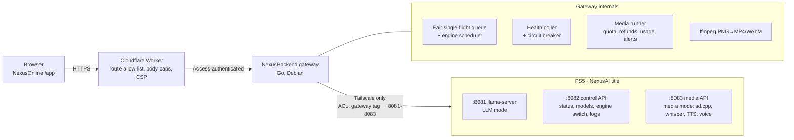

# PSllama → Nexus integration report

Date: 2026-11-17. Plan and discovery: [PSLLAMA-INTEGRATION-PLAN.md](PSLLAMA-INTEGRATION-PLAN.md).
Next phase (NixOS build and hardware): [NIXOS-HANDOFF.md](NIXOS-HANDOFF.md).
Nothing is committed. Nothing was built for the PS5 or run on the console; those steps are in
[TESTING.md](TESTING.md) for the NixOS build host and the console.

## 1. Summary

**What was built.** PSllama's media engines (stable-diffusion.cpp image and video, whisper.cpp speech-to-text,
mtmd text-to-speech, the voice pipeline) are ported into the NexusAI PS5 title as a second **media mode** next to
the existing LLM mode, following NexusAI's pin-and-patch convention. The NexusBackend gateway gained a PS5 provider:
a fair single-flight queue, an engine-aware scheduler, health polling with a circuit breaker, quotas, alerts,
usage logging without prompts, and eight new routes. NexusOnline gained status, image, video, audio and voice views
behind the existing Worker.

**Works now (verified on Windows):** every gateway unit and end-to-end test against a mock PS5 built from the
confirmed schemas; the whole NexusAI patch stack applies at the pinned revisions; NexusOnline unit tests, Worker tests
and build.

**Not verified yet:** anything compiled for the PS5, the C++ host tests, and all console behaviour. These need the
NixOS build host and the console (sections 6 and 9).

**Top risks.** (1) The port compiles only on NixOS; sd.cpp and whisper.cpp were built by PSllama against an older
llama.cpp, and `whisper-aneforge.cpp` calls `dlopen`, which the PS5 runtime may not provide. (2) Requests that wait
through a ~100 s model load may hit Cloudflare's origin timeout (Needs Verification for your plan). (3) Sign-in is
not yet auth.liamjc.dev with password + SMS OTP (U-48 is blocked on M-5). (4) One GPU and one request at a time: a
video job holds the PS5 for minutes.

## 2. Discovery report

Full detail with file:line citations is in the plan, §1.1–§1.4. Key points:

- **"NexusAI" in the brief was three repos.** NexusAI is the PS5 title (PS5LM-Plus + patches; :8081 inference,
  :8082 control API). The gateway is `NexusBackend/gateway` (Go, Debian, behind Cloudflare). The web client is
  `NexusOnline` (Astro + Cloudflare Worker).
- **Decision taken with you:** port PSllama's engines into NexusAI rather than run PSllama, with no cloud fallback.
- **PSllama facts:** ✅ engines, endpoints, one request at a time, image/video evicting the LLM, PNG-frame video,
  no raw completion endpoint, Tailscale-range peer filter plus a compile-time key. ❌ transcription takes base64 WAV
  inside JSON, not a multipart upload; there is also a `/v1/stats` endpoint. ⚠️ ~100 s first load, ~12 GiB heap and the
  10 s GPU timeout are only the author's own measurements.
- **Gaps found in the existing code and fixed:** the media API originally read up to 64 MiB before checking the token
  (U-75); the control API had no peer filter (U-76); chat showed "[object Object]" for nested gateway errors (U-73
  and a `lib.ts` fix).

## 3. Capability matrix

| Feature | Endpoint (gateway → PS5) | Default model (pending M-3) | Supported | Gaps | Fallback |
|---|---|---|---|---|---|
| Chat | `/v1/chat/completions` → :8081 | current LLM | Yes, now queued | Long waits through a model load (Cloudflare timeout risk) | Offline message |
| Vision | chat `image_url`, PNG/JPEG ≤ 4 MiB | LLM with `--mmproj` | Yes | Needs a vision model loaded | Offline message |
| Speech to text | `/v1/audio/transcriptions` → :8083 | whisper large-v3-turbo q5_0 | Yes (pending build) | WAV only, ≤ 60 s | Offline message |
| Text to speech | `/v1/audio/speech` → :8083 | qwen3-tts-1.7b | Yes (pending build) | Cloning UI hidden until a client-visible permission exists | Offline message |
| Voice chat | `/v1/voice/chat` SSE → :8083 | Whisper + Qwen3-4B + TTS | Yes (pending build) | System prompt text is a placeholder | Offline message |
| Image | `/v1/images/generations` → :8083 | sd-turbo-fp16 / flux2-klein-4b | Yes (pending build) | sd-turbo licence is restrictive | Offline message |
| Video | `/v1/videos/generations` → job → MP4 | wan2.1-t2v-1.3b | Yes (pending build) | ≤ 33 frames; result lives in memory, single read | Offline message |
| Robot policy (VLA) | — | — | No | Not ported; out of scope for Nexus | — |

## 4. Architecture

- **One engine at a time.** `model.txt` = `media` boots media mode; `POST /v1/nexus/engine/{media,llm}` restarts the
  title (about 30 s) into the other mode. The gateway switches automatically and groups queued jobs by engine to avoid
  swaps. In media mode, a GPU coordinator unloads whichever engines a request doesn't need.
- **Security model.** The browser never reaches the PS5. The PS5 token exists only on the gateway (systemd
  `LoadCredential`) and as a sha256 hash on the console. Both PS5 listeners admit only loopback and 100.64/10 peers,
  plus LAN peers when the marker file is present, and check the token before reading the body.

## 5. Changes

**NexusAI** (PS5 title)
- `patches/0010`: `GGML_MAX_NAME=160` everywhere.
- `patches/0011`: media-mode boot path.
- `patches/0012`: media build wiring.
- `patches/llama.cpp/0101`–`0104`: Vulkan memory budget, sampler `expf` underflow, Mamba-1 shader, tuning switches.
- `native/`: control API engine mode, `nexus_peer.hpp`, WAV and base64, the media path validator, SD and audio
  services, media HTTP core, image/video, audio and voice handlers, GPU coordinator, tests and fakes, `sd/CMakeLists.txt`.
- Scripts: `prepare-build.sh`, `scripts/check-patches.sh`, `test-media.sh`, `tools/ps5-build/build.sh`.
- Docs: `NOTICE`, README, CHANGELOG, `docs/TESTING.md`, `docs/MEDIA-API.md`, `docs/MODELS-LICENSES.md`, this report.

**NexusBackend** (gateway)
- `gateway/`: provider, queue, scheduler, health, client, video encoding, usage, validation, alerts, quota, secrets,
  AI status, media runner, the five media handlers, and wiring in `main.go`.
- Tests: chat, vision and end-to-end tests, mock PS5 and fixtures.
- Config: systemd units, `.env.example`, `openapi.yaml`.
- Docs: `docs/GATEWAY.md`, `docs/RUNBOOK-PS5.md`, `docs/tailscale-acl.example.hujson`.
- Scripts: `mock-ps5.py` and three Python test files.

**NexusOnline** (web)
- `src/app/`: `aistatus`, `queue`, `wav`, `image`/`image-core`, `video`, `audio`, `voice`, plus changes to `chat.ts`,
  `lib.ts` and `main.ts`. Each new module has tests.
- Worker: `worker/routes.js` and `worker/index.js`, with tests.
- Nav: `src/pages/app/index.astro`.

| Unit | Component | Main files | Tests | Status | Finished by |
|---|---|---|---|---|---|
| U-01 | docs | plan | — | Done | Opus |
| U-02 | infra | Go 1.27.4 | baseline | Done | Orchestrator (your OK) |
| U-03–U-15 | gateway core | provider, queue, scheduler, health, client, video, usage, validation, alerts, quota, secrets, mock, status | each `-run` suite | Done, verified | Haiku |
| U-16, U-16b | gateway wiring and runner | `main.go`, `media_runner.go` | TestChat*, TestMediaRunner* | Done, verified | Haiku |
| U-17–U-24 | gateway integration | chat, vision, STT, TTS, voice, image, video, routes and the PNG change | per-route suites | Done, verified | Haiku |
| U-25, U-26, U-31, U-33, U-43, U-44, U-45 | title build | check script, `prepare-build.sh`, patches 0010–0012, Docker pins | `check-patches.sh` | Done; build pending NixOS | Haiku |
| U-27–U-30 | title llama.cpp patches | 0101–0104 | `check-patches.sh` | Done; compile pending NixOS | Haiku |
| U-32, U-34–U-42 | title media code | services, server, handlers, tests | `test-media.sh`, `test-control.sh` | Written; compile pending NixOS | Haiku (U-37 on 2nd attempt) |
| U-46, U-47 | infra | NixOS build, hardware | — | **Not run (yours)** | — |
| U-48 | auth | Keycloak SMS OTP | — | **Blocked on M-5** | — |
| U-49, U-50 | infra | ACL example, `LoadCredential` | Python tests | Done, verified | Haiku |
| U-51, U-53–U-60 | NexusOnline | Worker, views, nav | node and Worker tests, build | Done, verified (U-53 on 2nd attempt) | Haiku |
| U-52 | title | :8081 API key | — | Dropped (your D-2) | — |
| U-61, U-62 | testing | `mock-ps5.py`, end-to-end tests | unittest, TestPS5E2E* | Done, verified | Haiku |
| U-63–U-68 | docs | media API, models, GPL notice, gateway docs, runbook, testing guide | — | Done | Haiku |
| U-69–U-79 | follow-ups found during work | shared path check, GPU coordinator, JSON parser, helpers, `lib.ts` errors, fairness, error shape, quota refunds, auth before body, control-API peer filter, offline abort, chat engine wait, docs | as listed | Done (C++ pending NixOS) | Haiku |

## 6. Hardware test checklist

The full steps and expected results are in [TESTING.md](TESTING.md), under "NixOS build" and "Hardware acceptance"
(H-0 to H-20). In short:
1. On NixOS: `bash scripts/check-patches.sh`, then `./prepare-build.sh`.
2. Run the host tests: WAV, media path, `./test-control.sh <tree>` and `./test-media.sh <tree>`.
3. Build the title and run the build checks: `GGML_MAX_NAME` in the CMake cache, `llvm-nm -u` for `dlopen`,
   `weak-unresolved.txt`, and title size.
4. Run the gateway suite on Linux with `-race`.
5. Install under a separate test title ID.
6. Boot LLM mode and check it is unchanged.
7. Switch to media mode through the control API, then run image, STT, TTS, voice and video, watching GPU memory
   between them.
8. Switch back to LLM mode.
9. Take the PS5 offline to test the breaker, and check that an unauthenticated large POST gets 401.

## 7. Security checklist

| Requirement | Status |
|---|---|
| Every AI endpoint requires a session | ⚠️ Every route goes through Cloudflare Access and the gateway's token check, as before. auth.liamjc.dev with password + SMS OTP is **not done**: U-48 is blocked on M-5, and Keycloak currently requires a passkey. |
| Per-role limits (e.g. video) | ✅ `ai.image`, `ai.video`, `ai.audio`, `ai.voice` and `ai.voice.clone` permissions. A permission with no quota rule is denied by default. |
| Tailscale ACL: only the gateway reaches the PS5 | ⚠️ Example policy written and tested (`docs/tailscale-acl.example.hujson`). Applying it to your tailnet is yours (M-1). Both PS5 listeners also filter peers. |
| Rate limits and quotas | ✅ Daily quotas with refunds, 3 queued jobs per user and 20 overall, fair turn-taking. ⚠️ Media routes are not in the per-minute request budget; the queue and quotas bound them. |
| Input validation | ✅ Checked three times: the Worker (size caps, anchored routes), the gateway (types, sizes, magic bytes, model allow-lists, path rules) and the console (strict JSON and base64, path traversal, header and body limits, token before body). |
| Model output treated as untrusted | ✅ Every view renders with `textContent` only; media goes through `data:` or `blob:` URLs. No tool actions come from model output. |
| Content policy and voice-cloning consent | ⚠️ Cloning needs `ai.voice.clone` plus explicit consent, and the reference audio is never stored. The policy text and consent wording are still yours to write (M-12). |
| Secrets | ✅ The PS5 token is only in systemd `LoadCredential` on the gateway and as a sha256 on the console. A test asserts no tokens, prompts or audio appear in logs. No secrets in the repos. TLS is unchanged (Cloudflare). |
| Logging and alerting | ✅ Alerts for auth failures, quota hits, PS5 offline and online (including offline at startup), request spikes and failed restarts. The webhook is HTTPS only. Which alert channel to use is yours (M-8). |

## 8. Known limitations and risks

- **Unverified on the console.** All PS5-side C++ is unverified until the NixOS build runs. The riskiest items are
  `dlopen` in `whisper-aneforge.cpp`, the sd.cpp and whisper.cpp builds against llama.cpp 620d2225, headers compiled
  without RTTI, and the FP8→F16 conversion's memory cost.
- **Cloudflare timeout.** Chat and image requests can stay open during a ~100 s model load or a ~30 s restart. Behind
  Cloudflare, the default origin timeout (about 100 s, Needs Verification for your plan) may end them with a 524.
  Video is unaffected. A possible follow-up: send keep-alive comments on the stream while waiting.
- **One quota unit for `ai.audio`.** STT is counted in seconds and TTS in requests, so one `ai.audio` quota rule fits
  only one of them.
- **Video results are in memory.** They're readable once, last 10 minutes, are capped at 128 MiB in total, and are
  lost on a gateway restart.
- **Untested pieces.** Voice handler: not covered by host tests (llama.cpp can't practically be faked). Peer-filter
  refusal in the accept path: not exercised (the classifier is tested).
- **Placeholders and pending decisions.**
  - Defaults (M-3, licences): image models sd-turbo-fp16 (restrictive licence) and flux2-klein-4b; video model
    wan2.1-t2v-1.3b; the voice LLM folder name; the gateway's voice system prompt.
  - Open decisions: D-4 (media port :8083 and model folder `/data/PS5LM/media`), M-1, M-2, M-4 to M-13.
- **Dashboard.** In media mode it shows "Media mode" as the model name, but the state word reads NO MODEL.
- **Crash recovery.** A PS5 crash can still need a reboot and re-jailbreak. The gateway shows "PS5 is offline"
  meanwhile and recovers automatically when the console is back.

## 9. Runbook

See `NexusBackend/docs/RUNBOOK-PS5.md` for:
- start and stop
- health and every `reason` value
- what to do for each alert
- step-by-step token rotation, and when a console rebuild is needed (pinned builds)
- crash and re-jailbreak recovery
- queue and quota settings
- adding a model (folder layout, allow-lists, licence check)
- the usage log

Model and API reference: `docs/MEDIA-API.md` and `docs/MODELS-LICENSES.md`.

## 10. Routing log

| Unit(s) | Final model | Attempts H/S/O | Escalation reason | Status |
|---|---|---|---|---|
| U-01 | Opus | 0/0/1 | — (planner) | Done |
| U-37 media HTTP core | Haiku | 2/0/0 | Retried once with feedback: token-file checks didn't match NexusControl's console sandbox exception | Done |
| U-53 status component | Haiku | 2/0/0 | Retried once with feedback: switching was detected from warning text instead of `reason` | Done |
| All other implemented units (U-03 to U-51, U-54 to U-79, excluding U-46/47/48/52) | Haiku | 1/0/0 | — | Done |
| U-02, plus two one-line fixes (`check-patches.sh` long paths, `lib.ts` error parsing) | Orchestrator | — | Too small to delegate | Done |
| U-46, U-47 | — | — | Needs NixOS and the console | Yours |
| U-48 | — | — | Blocked on M-5 | Blocked |
| U-52 | — | — | Dropped by D-2 | Dropped |

**Totals:**
- **Opus** finished one unit, the plan.
- **Sonnet** finished none.
- **Haiku** finished everything else that was implemented.

There were no Sonnet or Opus escalations. Two units needed a second Haiku attempt; both were cross-component
consistency issues that a precise correction fixed. Twelve follow-up units (U-69 to U-79, plus U-16b) were created
when workers reported cross-file duplication, contract mismatches, or security gaps that I checked against the code.
